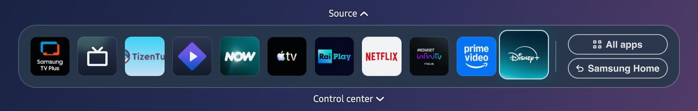
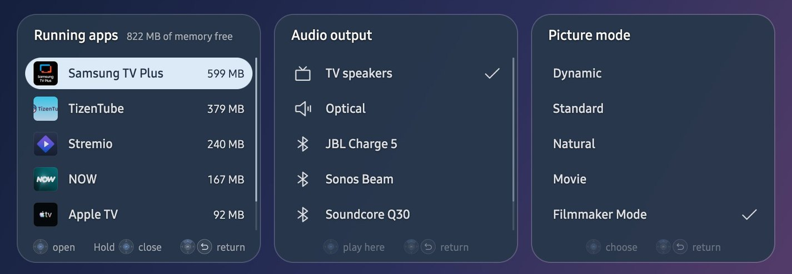
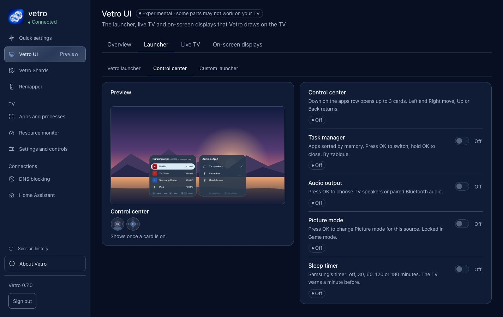
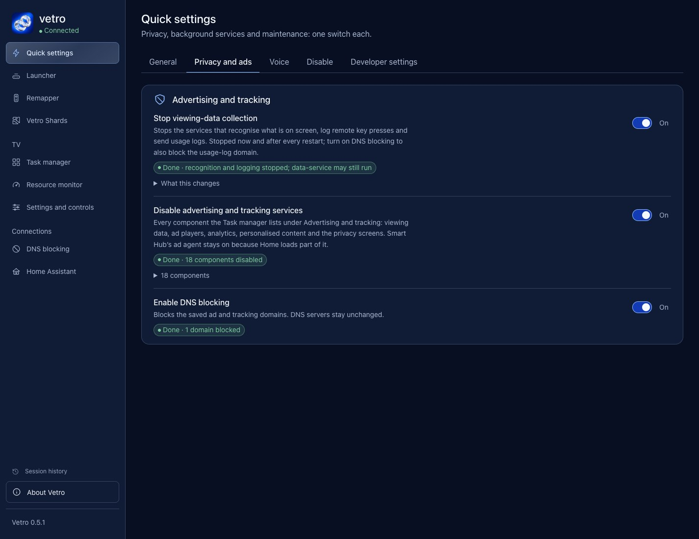
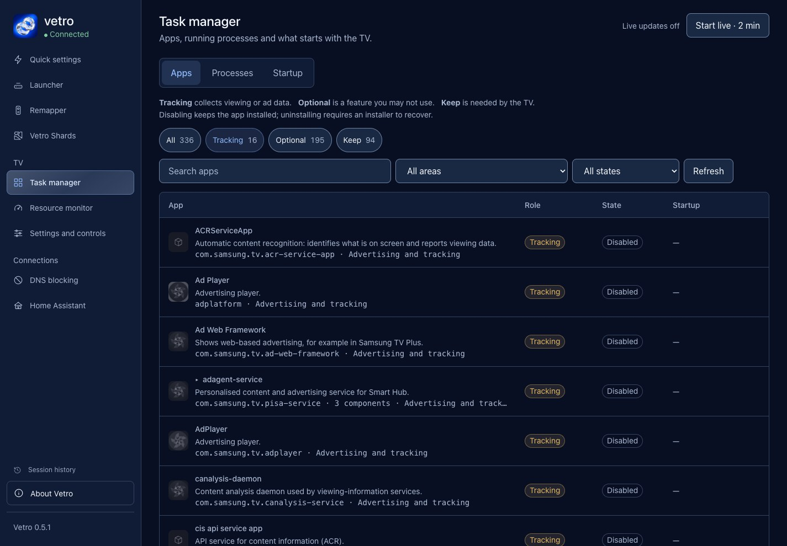
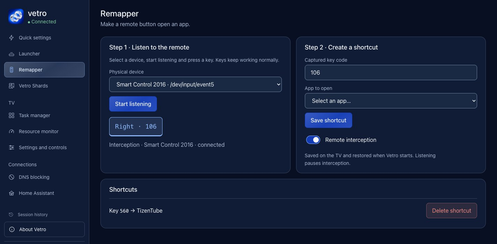

<p align="center">
  
</p>
<h1 align="center">Vetro</h1>
<p align="center"><strong>Launcher. Debloater. Remapper.<br>The all-in-one TV manager for Samsung Tizen.</strong></p>
<p align="center">Manage your Samsung TV from a browser, and give it a launcher, a Control center and a live TV screen of its own.</p>
<p align="center">
  <a href="#whats-new-in-071">What's new</a> ·
  <a href="#vetro-ui-preview">Vetro UI</a> ·
  <a href="#debloater">Debloater</a> ·
  <a href="#remapper">Remapper</a> ·
  <a href="#install">Install</a> ·
  <a href="#compatibility">Compatibility</a> ·
  <a href="https://discord.gg/Pe9BmthUar">Discord</a>
</p>

Vetro runs on your Samsung TV and gives you a dashboard, open from any computer or phone on your network. Root access enables the launcher, privacy switches and remapper. It has been reported working on selected TVs running **Tizen 6 through 10**, depending on the model and firmware. The dashboard, app list and diagnostics can work without root on supported models. See [Compatibility](#compatibility).

> [!IMPORTANT]
> **A Samsung firmware update can remove root access.** Vetro's **Block firmware and software updates** switch (Quick settings → General → Essential settings) requires root, is off by default and reapplies the block after a restart. Vetro 0.7.1 extends the block to Samsung's separate update mode. The original block was tested on a Q80A. An update reached a QE65S85F with blocking enabled before the 0.7.1 changes, which still need testing on a TV. [Update report](https://github.com/andrearicci93/vetro/issues/308) · [0.7.1 changes](CHANGELOG.md#update-lock) · [Blocking updates without root](app/docs/UPDATES-WITHOUT-ROOT.md)

<p align="center">
  
  <br><em>The Vetro launcher, rendered from its own code in Vetro's preview.</em>
</p>

## What's new in 0.7.1

- **Tizen 10 root support.** Root access was reported on four model and firmware combinations with test builds. See [Compatibility](#compatibility).
- **Save and load settings.** Keep a file with your Vetro settings before a reinstall or move them to another TV.
- **Turn off the screen from the remote.** Assign Picture Off to a button in the Remapper and keep listening with the picture off.
- **Samsung Odyssey OLED G8 inputs.** HDMI, DisplayPort and USB-C are available in the launcher, Remapper and Home Assistant on monitors with that input layout.
- **Home Assistant channel sensor.** See the current channel while watching TV through Vetro's tuner.

See the full [0.7.1 changelog](CHANGELOG.md#071--2026-11-26).

## What's new in 0.7.0

- **Vetro UI (Preview).** Vetro now draws its own TV: a launcher with your own row and All apps, a Control center, a live TV screen, and its own volume bar and number pad, all on one page of the dashboard.
- **Block firmware and software updates** now covers Samsung's update services, not only the Auto update setting. On firmware with the AT-HUB boot step (Tizen 6, 6.5 and 9 have it), the block is applied at power-on, before the update services start. Tried on a Q80A only.
- **More to switch off.** Apps you don't use (Netflix, Prime Video, Disney+, Spotify and more), Samsung TV Plus, Vision AI, and a new **Uninstall** tab.
- **The Remapper can send a key**: an HDMI input, Play/Pause, Home, the arrows or the volume keys.
- Many fixes from your reports, and from the code reviews and pull requests of the community.

Everything is in the [changelog](CHANGELOG.md).

## Vetro UI (Preview)

Vetro UI is everything Vetro draws on the TV. You switch each part on in the dashboard's **Vetro UI** page, and each one can be turned off again: Samsung's own screens come back.

> [!NOTE]
> **Vetro UI is in preview.** It is new in 0.7.0 and is still taking shape with your reports. It is developed on a Q80A, and testers have tried parts of it on other models; some parts may not work on your TV yet. If something does not work, download a diagnostic report (Quick settings → Developer settings → Diagnostic report → Download report) and attach it to a [log report issue](https://github.com/andrearicci93/vetro/issues/new?template=log_report.yml), with your TV model and what you pressed. See [Report a problem](#report-a-problem).

- **Launcher.** A fast launcher on the Home key. It starts from Samsung's Home row, and then the row is yours: hold OK on a tile to move it or take it out. **All apps** lists the apps of Samsung's Apps screen, plus Samsung TV Plus and Live TV, and the Sources page (Up) can add a TV or HDMI input to the row. After the first Home press, Samsung's Home no longer flashes before the launcher (tried on a Q80A with simulated presses). **Samsung Home** is one press away, and nothing is removed. Prefer another app on Home? **Custom launcher** opens an app you installed instead.
- **Control center.** Down on the apps row opens up to three cards side by side: **Task manager** (running apps by memory; hold OK to close one), **Audio output** (TV speakers, optical, a receiver or a Bluetooth device, and a row that turns the screen off while the sound plays on), **Picture mode** and **Sleep timer**. A Shard can add a card of its own, for example for Home Assistant.
- **Live TV.** Vetro TV Tuner draws its own Banner, Channel list, Channel pad, Info, TV guide and Audio toast over the picture, in place of Samsung's. Samsung's tuner is never removed or changed. Tried on a Q80A with an antenna (DVB-T); cable and satellite are untested. [Guide](app/docs/TUNER.md).
- **Volume bar and number pad.** Vetro's own volume bar (on any edge of the screen, or hidden) and number pad. They need the remote interception, which Vetro turns on by itself when it finds one remote; with an optical soundbar, a receiver on HDMI or Bluetooth audio, Vol goes to Samsung, which shows its own bar.

**It frees memory.** With the launcher on, Vetro closes Samsung's Home once the TV has settled after a boot (you can still open it). In one measurement on a Q80A, available RAM went up by about 24% (533 MB to 662 MB); other TVs will differ. Method and numbers in the [performance evidence](app/docs/PERFORMANCE.md). [Vetro UI guide](app/docs/VETRO-UI.md).

<p align="center">
  
  <br><em>The Control center, rendered from the launcher's code in Vetro's preview (sample apps and devices).</em>
</p>

<p align="center">
  
  <br><em>The Vetro UI page in the dashboard.</em>
</p>

## Debloater

Samsung TVs ship with advertising, viewing-data collection, voice assistants and background services you never asked for. Vetro lets you see them and switch them off, and every switch can be turned back on.

**Quick settings** groups them in tabs:

- **General**: Software update, Storage (*Clear leftovers*), and **Essential settings**: *Block firmware and software updates*, *Disable background app delivery* and *Allow SDB from the local network* (helps Apps2Samsung and TV-Store reach the TV). *Settings file* (save your Vetro choices to a file and load them again after a firmware update, a reset or on another TV), *Restore the TV* and *Remove Vetro* are here too.
- **Privacy and ads**: *Stop viewing-data collection* (screen recognition, key-press logging and usage logs, now and after every restart), *Disable advertising and tracking services* and *Enable DNS blocking*, a filter on the TV itself that keeps your DNS servers.
- **Voice**: turn off all voice assistants, or Alexa, Google Assistant, Bixby and the other voice services one by one.
- **Disable**: HbbTV, Multi View autostart, Ambient, AirPlay, Samsung TV Plus, Vision AI (the AI screens that a long Home press opens on newer TVs), Gaming Hub, SmartThings, SmartThings Find, Sound Sensor and Pet Care, and apps you don't use, with their background services.
- **Experimental**: *Extra performance mode* (closes apps left in the background for 15 minutes, sooner when memory runs low, and changes no other setting), *Quick boot* (starts Vetro and the launcher earlier after power-on; measured on a Q80A only) and *Hide remote key guides*: new settings, or settings that may not work on every TV.
- **Uninstall**: delete some of the apps that came with the TV (Netflix, Prime Video, Disney+ and others, Samsung TV Plus) and the e-Manual, where the TV allows it. YouTube is not on this list: switch it off under Disable. **Keep removed apps removed** keeps them off the TV.

Each switch shows what it did (*Done*, *Partly done*) or why it is not available on your TV. Turning voice off also turns off the remote's microphone button; Vetro asks you to confirm. Domain filtering does not guarantee that every app's ads or telemetry are blocked.

<p align="center">
  
  <br><em>Quick settings, Privacy and ads.</em>
</p>

**Apps and processes** (the Task manager page of earlier versions) lists every app and service on the TV with a plain description and a role: **Tracking**, **Optional** or **Keep**. Search by name, package or purpose, then disable, stop or uninstall with an in-page confirmation. Protected system components cannot be touched. Hotel, shop and factory apps open only after a warning, and never from a remapper, MQTT or HTTP rule; the factory colour test (AgingApp) and the service menu are never opened.

<p align="center">
  
  <br><em>Find viewing analytics and advertising components without guessing what they do.</em>
</p>

Disabling a component keeps it installed and can be reversed; stopping ends the running process; uninstalling needs an installer to recover. Descriptions cover the common Samsung packages.

**Restore or remove:** *Quick settings → General → Restore the TV* shows the changes Vetro recorded and puts them back after one confirmation. Uninstalled apps, settings without a saved previous value and changes made by Shards need manual recovery. *Remove Vetro* can then delete Vetro's saved data and explains how to delete the app. [Steps →](app/docs/INSTALLATION.md#uninstalling)

## Remapper

Do what you want with the remote. Press a button, then choose what it does: open an app, press another key (an HDMI input, the TV input, Play/Pause, Home, Back, the arrows or the volume keys), or turn the screen off while the sound plays on (press any key but Volume and Power to bring it back). Shortcuts survive restarts, and the Home Assistant page can also turn a key press into an MQTT message.

The Odyssey OLED G8 and monitors with the same HDMI + DisplayPort + USB-C configuration offer those three input choices. Other devices keep Vetro's default input options. The **Settings and controls → Network and inputs → Inputs** tab detects the same layout. [Input compatibility and validation](app/docs/INPUTS.md).

<p align="center">
  
</p>

## Also included

- **Vetro Shards (plugins):** add-ons written by other people, installed from a [public list](https://github.com/andrearicci93/vetro-plugins) or a file, off until you switch them on. A Shard can add a page to the dashboard, a card to the Control center or take over an app's tile in the launcher. They are third-party code, not sandboxed (a Shard can do what Vetro can, including running commands as root) and only spot-checked: read the warning in [the Shard guide](app/docs/plugins.md), which also explains how to write and publish one.
- **Settings and controls:** change supported picture and advanced settings, check the value the TV saved, restore saved values and send remote keys to the TV.
- **MQTT and Home Assistant:** the TV's sensors and controls in Home Assistant, and actions triggered by MQTT topics. [Setup guide](app/docs/mqtt/README.md).
- **Resource monitor:** CPU, RAM, swap, storage and processes. Live sampling starts when you ask and stops after two minutes.
- **Updates.** From Vetro 0.7.0 onward, the dashboard can install signed updates without a reinstall while root is connected. If the new version fails to start, the updater restores the previous version. The **Update Vetro** tile on the TV offers the same update and still needs testing on a TV. [How it works](app/docs/UPDATING.md)
- **Diagnostics:** a redacted report to share in an issue. [Report format](app/docs/DIAGNOSTIC-EXPORT.md).

## Install

Vetro needs root for the launcher, privacy switches and remapper. You can install it in three ways.

- **1. Apps2Samsung (the fastest).** Vetro is in the catalog of [Apps2Samsung](https://github.com/Apps2Samsung/Apps2Samsung), the one-click installer for Samsung TVs by [PatrickSt1991](https://github.com/PatrickSt1991). It handles the certificate, the signing and the install for you. Thanks, Patrick!
- **2. With a coding agent.** Let an AI coding agent with a terminal (for example Codex or Gemini CLI) follow the guide for you. Not Claude: its cybersecurity safeguards stop it on the root steps.
- **3. Manual.** Tizen Studio, your own Samsung certificate, build, sign and install, step by step.

Whichever way you choose, finish with the same two steps: **open Vetro once** on the TV, then set **Host PC IP** to `127.0.0.1` in Developer Mode and restart the TV. Then open the dashboard from a phone or computer on the same network, at the address the Vetro app shows on the TV (port 8099 by default). [Full guide for all three ways →](app/docs/INSTALLATION.md)

**Already on Vetro 0.7.0?** With root connected, open *Quick settings → General → Software update*, press **Check for update**, then **Update**. Your settings stay. If you are on **0.5.0 or earlier**, install the current version with Apps2Samsung or follow the installation guide. [Supported update paths](app/docs/UPDATING.md#which-versions-can-update)

The root comes from [Chris Ritsen's Samsung TV root research](https://github.com/chris-ritsen/samsung-tv-root) and works through TV-local SDB, so no computer needs to stay connected. Startup time varies by TV; wait for the status shown in the Vetro app. This is experimental software: privileged changes can disrupt TV features, so read what a switch does before turning it on.

**Pairing is automatic by default:** once the Vetro app on the TV has been seen, every browser or script pairs once with a 6-digit code shown on the TV; until then (and on a TV whose app is never recognised) the dashboard is open and says so. **Require pairing** (Developer settings → Pairing) lets you force it on or off ([sign-in](app/docs/SIGN-IN.md)). Traffic is plain HTTP, so keep the TV on a trusted LAN and never expose it to the Internet. [Integration details](rooting/README.md) · [Validation record](app/docs/RELEASE-AUDIT.md)

## Report a problem

The fastest way to get a problem fixed is a diagnostic report from your TV:

1. Open the dashboard: **Quick settings → Developer settings → Diagnostic report → Download report**.
2. Read the file. It has no passwords, network addresses, device ids, MQTT messages, raw logs or viewing history, but it does list app names.
3. Open a [log report issue](https://github.com/andrearicci93/vetro/issues/new?template=log_report.yml) with your exact TV model and firmware, what you did and what happened, and attach the report.

For Vetro UI, say which part (launcher, Control center, Live TV, volume bar, number pad) and which keys you pressed. Reports from TVs where everything works help too: they go into the compatibility table below.

## Compatibility

Vetro is developed on a **Samsung Q80A**. The table also draws on community reports and diagnostics. Find your model and firmware under **Settings › Support › About this TV**. Check the exact firmware because two TVs from the same year can run different Tizen versions.

**Tizen 10 root support starts in Vetro 0.7.1.** The four positive reports below came from test builds on firmware variants ending in **2103.1**. They confirm that root connected on those sets. Feature coverage varies by model, and field reports for the final 0.7.1 build are still pending. [Tizen 10 validation summary](CHANGELOG.md#tizen-10)

**2022 TVs on firmware 1722.0 or 1722.1.** Owners reported losing root or being unable to connect on these versions. Vetro 0.7.1 can attempt recovery, which still needs confirmation on the affected TVs. [Firmware reports](https://github.com/andrearicci93/vetro/issues/223) · [1722.1 report](https://github.com/andrearicci93/vetro/issues/319)

| Tizen (typical year) | Dashboard, app list, diagnostics | Root features (launcher, privacy switches, remapper) | Reports |
| --- | --- | --- | --- |
| **10** (2025–2026) | Reported working on some models | Root connected in test builds on the QE65S85F, Q70F, U8000F and QN900F on 2103.1. See the model reports for earlier failures. | QE65S85F, Q70F, U8000F, QN900F, M70H, M73H, U8000H, QN80F |
| **9** (2024–2025 and some older TVs after updates) | Reported working | Reported working on some TVs. Some TVs have service connection or root issues ([#122](https://github.com/andrearicci93/vetro/issues/122), [#99](https://github.com/andrearicci93/vetro/issues/99)). | S90C, S90D, S90F, S95F, Q7F, GU75CU7179, DUE77, DU6900, DU7700, CU8070 |
| **7 and 8** (2023–2024) | Reported working | Reported working | S90C, S95C, Q65D, QN90D, DU7000, DU7179 |
| **6.5** (2022) | Reported working | Reported working on 1720.7. Root failures were reported on 1722.0 and 1722.1. | Q60B, Q67B, QN85B, QN90B, S95B, BU8002, BU8075, The Frame, Odyssey OLED G8 |
| **6** (2021) | Reported working | Reported working; one TV needs the Host PC IP step to be confirmed ([#134](https://github.com/andrearicci93/vetro/issues/134)) | Q80A, Q70A, Q60A, QN85A, QN95A, AU7000, AU7170, AU7172 |
| **5.5** (2020) | Reported working | Not available | TU7090, T4300 |
| **5.0** (2019) | Not with the stock package | One Q80R works with a personal port ([#35](https://github.com/andrearicci93/vetro/issues/35)) | Q80R |
| **4** (2018) | Reported working | Not available | NU7090 |

<details>
<summary>Reports by model</summary>

| TV | Firmware | Status |
| --- | --- | --- |
| **Q80A** QE50Q80AATXZT (2021) | T-NKM2DEUC-2301.1 | **Developed and tested here** |
| Q70A QE55Q70AATXXC (2021) · [#8](https://github.com/andrearicci93/vetro/issues/8) | T-NKM2DEUC-2301.1 | Reported working |
| Q60A QN70Q60AAVXZC (2021) · [#28](https://github.com/andrearicci93/vetro/issues/28) | T-NKLAAKUC-2310.0 | Reported working; the listen port was changed to avoid a clash with tizen-youtube |
| QN85A GQ65QN85AATXZG (2021) | T-NKM2DEUC-2301.1 | Reported working, back after a reboot |
| UE43AU7172UXXH (2021, Tizen 6.0) · [#182](https://github.com/andrearicci93/vetro/issues/182) | T-KSU2EDEUC-2301.1 | Vetro 0.5.0, diagnostic report only: root agent with UID 0, service running and loopback probe succeeded; start after a cold boot not checked |
| UE43AU7170UXZT (2021, Tizen 6.0) · [#195](https://github.com/andrearicci93/vetro/issues/195) | T-KSU2EDEUC-2310.0 | Reported working with Vetro 0.5.0, installed with a coding agent following the guide |
| QN95A 65QN95A (2021, Tizen 6.0) · [#165](https://github.com/andrearicci93/vetro/issues/165) | 2310.0 | Vetro 0.5.0, diagnostic report only: root agent connected |
| Q67B QE43Q67BAUXXH (2022) | T-NKLBDEUC-1720.7 | Reported working |
| Q60B QE43Q60BAUXXC (43", 2022, Tizen 6.5) | T-NKLBDEUC-1720.7 | Vetro 0.5.0: dashboard, UID-0 agent, dock and physical Home key verified; service, root and dock recovered automatically after a software restart (observed after about 100 s). Power-cut recovery not tested. |
| UE65BU8002KXXH (2022) · [#22](https://github.com/andrearicci93/vetro/issues/22) | T-KSU2EBDEUC-1720.7 | Reported working; the Launcher needed the 0.3.1 fix for the Home cache folder |
| QE75QN85BATXXU (2022) · [#25](https://github.com/andrearicci93/vetro/issues/25) | 1720.7 | Core functions reported working; the Launcher failed before 0.3.1 (Home cache folder) |
| QN90B QE55QN90BATXXH (2022, Tizen 6.5) · [#158](https://github.com/andrearicci93/vetro/issues/158) | T-PTMDEUC-1720.7 | Reported working with Vetro 0.5.0 (Apps2Samsung): root agent with UID 0 after setting Host PC IP to 127.0.0.1 and restarting; the physical Home key opens a custom launcher. Another cold boot not tested |
| BU8075 UE43BU8075U (2022, Tizen 6.5) · [#223](https://github.com/andrearicci93/vetro/issues/223) | T-KSU2EBDEUC-1722.0 | Root was lost after the firmware update from 1720.7 |
| QN90B (2022, Tizen 6.5) · [#223](https://github.com/andrearicci93/vetro/issues/223#issuecomment-7097349522) | 1722.1 | Root unavailable in the report |
| Q60B QN75Q60BDFXZA (2022, Tizen 6.5) · [#319](https://github.com/andrearicci93/vetro/issues/319) | 1722.1 | Root unavailable with Vetro 0.7.0 |
| Odyssey OLED G8 LS34BG850SNXZA (Tizen 6.5) · [#316](https://github.com/andrearicci93/vetro/issues/316) | T-PTMLWWC-1720.7 | Root, launcher and remote interception verified on a test build for the input fix |
| QN55S95B QN55S95BAFXZA (2022) · [#14](https://github.com/andrearicci93/vetro/issues/14) | T-PTMAKUC-1720.7 | Reported working |
| Q65S95C (2023) · [#13](https://github.com/andrearicci93/vetro/issues/13) | T-PTMCDEUC-0090-2220.4 | Reported working |
| GU75CU7179 (2023, Tizen 9.0) · [#17](https://github.com/andrearicci93/vetro/issues/17) | Tizen 9.0 (23_KSUE_UB_T09) | Reported working, installed with Apps2Samsung |
| QN55Q65D QN55Q65DAGXZS (2024) · [#10](https://github.com/andrearicci93/vetro/issues/10) | T-NKLDUABC-0090-2123.9 | Reported working, installed with Apps2Samsung |
| Q60D (2024) · Reddit | Not reported | Reported working in a Reddit comment; no model code, firmware, Tizen or Vetro version given |
| S90C TQ65S90CATXXC (2023, Tizen 7.0) · [#16](https://github.com/andrearicci93/vetro/issues/16) | T-PTMCDEUC-2000.2 | Reported working |
| S90C QN65S90CAFXZA (2023, Tizen 9) · [#317](https://github.com/andrearicci93/vetro/issues/317) | T-PTMCAKUC-0090-2220.4 | Service and root verified with Vetro 0.7.0 |
| S90D QA65S90DAULXL (2024, Tizen 9) · [#36](https://github.com/andrearicci93/vetro/issues/36) | T-PTMDUABC-0090-2130.0 | Reported working, with the root agent back after a full restart (the owner's account) |
| UA55DUE77AKLXL (Crystal UHD DUE77, 2024, Tizen 9) · [#180](https://github.com/andrearicci93/vetro/issues/180) | T-KSU2EDUABC-0090-2130.0 | Reported working with Vetro 0.3.5: root agent with UID 0 after a full restart without opening Vetro; the bundled dock opens from the physical Home key |
| UE43CU8070UXXN (2023, Tizen 9.0) · [#183](https://github.com/andrearicci93/vetro/issues/183) | 2220 | Reported working with Vetro 0.5.0 (Apps2Samsung): root agent with UID 0 after setting Host PC IP to 127.0.0.1 and restarting; the physical Home key opens a custom launcher, with Samsung Home kept |
| QN90D QN55QN90DAFXZA (2024, Tizen 8) · [#185](https://github.com/andrearicci93/vetro/issues/185) | T-PTMDAKUC-1310.1 | Reported working with Vetro 0.3.5 (Apps2Samsung): root agent, the launcher with the Home row, HDMI inputs and app launches |
| UN65DU6900FXZA (Crystal UHD DU6900, 2024, Tizen 9) · [#68](https://github.com/andrearicci93/vetro/issues/68) | T-KSU2EDAKUC-0090-2130.0 | Reported working with Vetro 0.3.5: root agent with UID 0 after setting Host PC IP to 127.0.0.1 and restarting; custom launcher running |
| UA85DU7700WXXY (Crystal UHD DU7700, 2024, Tizen 9) · [#72](https://github.com/andrearicci93/vetro/issues/72) | T-KSU2EDUABC-0090-2130.0 | Reported working with Vetro 0.3.5 (Apps2Samsung, installed under a new package ID): root and Debloater |
| DU7000 / DU7179 (Tizen 8) · [#313](https://github.com/andrearicci93/vetro/issues/313) | T-KSU2EDDEUC-1400.0 | Reported working with Vetro 0.7.0 |
| S90F (2025, Tizen 9) · [#85](https://github.com/andrearicci93/vetro/issues/85) | T-RSMFAKUC-0090-1301.0 | Reported working with Vetro 0.3.5 on port 9000 (another YouTube app uses 8099) |
| S95F QN65S95FAFXZA (2025, Tizen 9) · [#284](https://github.com/andrearicci93/vetro/issues/284) | T-RSMFAKUC-0090-1301.0 | Root reported working across restarts with Vetro 0.7.0 |
| Q7F QN43Q7FAAFXZA (2025) · [#203](https://github.com/andrearicci93/vetro/issues/203) | Not reported | Reported working; no firmware or Vetro version given |
| S85F QE65S85FAEXXH (2025, Tizen 10) | T-PTMFDEUC-0100-2103.1 | Root connected in the contributor's test build. An earlier report records root loss after a Samsung firmware update ([#308](https://github.com/andrearicci93/vetro/issues/308)) |
| Q70F (2025, Tizen 10) | T-RSLFDEUC-0100-2103.1 | Root connected in a test build |
| U8000F (2025, Tizen 10) | T-KSU2EFAKUC-0100-2103.1 | Root connected in a test build |
| QN900F QA65QN900FWXXY (2025, Tizen 10) | T-OSCPFUABC-0100-2103.1 | Root connected after retries in a test build. The launcher was off during the test. Earlier builds failed on this model ([#193](https://github.com/andrearicci93/vetro/issues/193), [#194](https://github.com/andrearicci93/vetro/issues/194)) |
| QN80F (2025, Tizen 10) · [#181](https://github.com/andrearicci93/vetro/issues/181) | 2103.1 | Root stopped connecting with Vetro 0.5.0 after a firmware update. Root is still unconfirmed on this model with 0.7.1 |
| M70H, M73H, U8000H (2026, Tizen 10) | Varies by model | Earlier builds had service or dashboard reports and root failures. Root remains unconfirmed on these models with 0.7.1 ([#91](https://github.com/andrearicci93/vetro/issues/91), [#140](https://github.com/andrearicci93/vetro/issues/140), [#177](https://github.com/andrearicci93/vetro/issues/177), [#178](https://github.com/andrearicci93/vetro/issues/178)) |
| LS03B QN75LS03BAFXZA (The Frame, 2022) · [#39](https://github.com/andrearicci93/vetro/issues/39) | T-PTMAKUC-1720.7 | Reported working, the service started by itself after a cold boot; the Launcher was not tried |
| Smart Monitor M8 LS32BM801UNXGO · [#15](https://github.com/andrearicci93/vetro/issues/15) | T-PTMWWC-1720.7 | Installed, service and root agent running; what works not reported yet |
| Q80R QN65Q80RAFXZA (2019, Tizen 5.0) · [#35](https://github.com/andrearicci93/vetro/issues/35) | T-MSMAKUC-1500.5 | Works with **local changes**, not with the stock package: a personal port with its own launcher host, app registry paths and Node.js 16.20.2, not reviewed or merged |
| UA50AU7000 UA50AU7000UXTW (2021, Tizen 6) · [#134](https://github.com/andrearicci93/vetro/issues/134) | T-KSU2EUABC-2310.0 | Service and dashboard reported working; the root agent did not connect (the Host PC IP step was not confirmed), so the features that need it stay off |
| UE43TU7090 UE43TU7090UXZT (2020) · [#132](https://github.com/andrearicci93/vetro/issues/132) | T-KTSU2DEUC-2501.1 | Dashboard, app list and diagnostics reported working; features that need root access are unavailable |
| UN32T4300 UN32T4300AGXZD (2020) · [#128](https://github.com/andrearicci93/vetro/issues/128) | T-KTS2UABC-2743.0 | Dashboard, app list and diagnostics reported working; features that need root access are unavailable |
| UE43NU7090 (2018, Tizen 4) · [#2](https://github.com/andrearicci93/vetro/issues/2) | 1400.2 | Dashboard, app list and diagnostics reported working; features that need root access are unavailable |

</details>

**Add your TV.** Open a [diagnostic report issue](https://github.com/andrearicci93/vetro/issues/new?template=log_report.yml) with your exact model and firmware, what worked or failed, and the report from **Quick settings → Developer settings → Diagnostic report**. The report has no passwords, network addresses, device ids or viewing history, but it lists app names: read it before you upload it. Failed attempts help too.

## Community

Questions, ideas or a new TV to report? Join the [Vetro Discord](https://discord.gg/Pe9BmthUar), or open an [issue](https://github.com/andrearicci93/vetro/issues).

## Development

The app has no npm runtime dependencies. Use a maintained Node.js release and Python 3.10+ for repository checks.

```sh
git clone https://github.com/andrearicci93/vetro.git
cd vetro/app
npm test
npm start
```

Open `http://127.0.0.1:8099/`. Local mode serves the UI with device operations unavailable; it does not simulate a connected TV. The separate [integration builder](rooting/README.md) adds the TV adapter and runtime payloads to the app package. If the app reports that the TV platform adapter is unavailable, you installed the app-only package: see [troubleshooting](app/docs/INSTALLATION.md#if-the-dashboard-says-the-root-agent-is-not-connected) (section "If the dashboard says the root agent is not connected" in `app/docs/INSTALLATION.md`).

From the repository root, run the remaining checks:

```sh
node rooting/tests/run.cjs
dotnet run -c Release --project dock/tests
python3 .github/scripts/test_parse_log.py
python3 .github/scripts/audit_release.py
```

The launcher (`dock/`) and the tuner (`tuner/`) are .NET programs that run on the TV's own runtime; `sh dock/build.sh` rebuilds the launcher into `app/native/dock/`.

[App & platform contract](app/README.md) · [Contributing](CONTRIBUTING.md) · [Security](SECURITY.md) · [Changelog](CHANGELOG.md)

## Contributors

Thanks to the people who contributed code and documentation to Vetro (including adapted work whose PR was not merged on GitHub):

- [swiezaczek](https://github.com/swiezaczek): a code review and fixes taken into 0.7.0: keyless remote parts no longer listed, payload folders for later updates, pairing refused to sandboxed pages, Shard isolation in Restore the TV, smaller launcher icons, MQTT topics in place, release checks, the YouTube tile fallback, systemd restarts without waiting, the Channel list hold and Task manager fixes ([#218](https://github.com/andrearicci93/vetro/pull/218), [#227](https://github.com/andrearicci93/vetro/pull/227), [#231](https://github.com/andrearicci93/vetro/pull/231), [#241](https://github.com/andrearicci93/vetro/pull/241), [#243](https://github.com/andrearicci93/vetro/pull/243), [#245](https://github.com/andrearicci93/vetro/pull/245), [#249](https://github.com/andrearicci93/vetro/pull/249), [#258](https://github.com/andrearicci93/vetro/pull/258), [#259](https://github.com/andrearicci93/vetro/pull/259), [#268](https://github.com/andrearicci93/vetro/pull/268), [#270](https://github.com/andrearicci93/vetro/pull/270)).
- [chemicalsno](https://github.com/chemicalsno): the idea and first version of the launcher's Home claim, which keeps Samsung's Home from flashing before the launcher ([#184](https://github.com/andrearicci93/vetro/pull/184)).
- [genesai](https://github.com/genesai): SVT Play and other HbbTV-link apps open from Vetro ([#211](https://github.com/andrearicci93/vetro/pull/211)), tried on a Samsung The Frame LS03B.
- [BirikuSistema](https://github.com/BirikuSistema): the input watcher that picks up a Bluetooth remote coming back from standby ([#219](https://github.com/andrearicci93/vetro/issues/219)).
- [zerodevb](https://github.com/zerodevb): dashboard and API pairing sign-in ([#9](https://github.com/andrearicci93/vetro/pull/9)).
- [Firaenix](https://github.com/Firaenix): CoBA multi-app Home guard, still selection, raw navigation and delayed Home echoes, adapted into the bundled launcher ([#23](https://github.com/andrearicci93/vetro/pull/23), [#24](https://github.com/andrearicci93/vetro/pull/24)).
- [pponce](https://github.com/pponce/vetro): remote input and queued actions are cancelled when the service stops ([#138](https://github.com/andrearicci93/vetro/issues/138)), and the first fix and S95C test for the Samsung Home pill on 2022 and later TVs ([#169](https://github.com/andrearicci93/vetro/pull/169)).
- [zabique](https://github.com/zabique/vetro) (branch `fork/extras`): the ideas and first implementations of Keep removed apps removed, Disable AirPlay, the restart check after a snapshot boot and stopping the HbbTV service app, re-written for Vetro; and the Task manager of the Control center ([#172](https://github.com/andrearicci93/vetro/pull/172)).
- [samshush](https://github.com/elithrar/samshush) by elithrar: the ideas behind the 0.7.1 Disable additions (Samsung's own "do not start" files for the voice and Health services, the services masked early in the boot, Samsung remote support, background app delivery and Wi-Fi presence, the TV Plus power-on setting, and checking that a stopped app's process is gone), each checked on a Q80A and re-written for Vetro; no code was copied.
- [skjnldsv](https://github.com/skjnldsv): measured that The Frame 2025 (Tizen 9) blocks loopback for apps and proposed reaching the service through the TV's own address ([#122](https://github.com/andrearicci93/vetro/issues/122), [#123](https://github.com/andrearicci93/vetro/pull/123)); adapted for the sign-in. Not tried on a TV yet.
- [Merennor](https://github.com/Merennor): Node 4.4 compatibility for the integration adapter and unsupported-root fallback on Tizen 4 ([#75](https://github.com/andrearicci93/vetro/pull/75)).

- [MaomaoADHD](https://github.com/MaomaoADHD): the Tizen 10 root backend through Samsung's `vddebugmenu`, validated on a QE65S85F (Tizen 10, 2103.1) ([#309](https://github.com/andrearicci93/vetro/pull/309)), and the request for a file with your Vetro settings ([#307](https://github.com/andrearicci93/vetro/issues/307)).
- [paradox12357](https://github.com/paradox12357): the inputs of the Samsung Odyssey OLED G8 (HDMI, DisplayPort, USB-C) in the launcher, the Remapper and Home Assistant, and input switching in the TV manager, tested on the monitor ([#314](https://github.com/andrearicci93/vetro/pull/314), [#316](https://github.com/andrearicci93/vetro/issues/316)).

- [tomcraft](https://github.com/tomcraft): direct TV-tuner key, and the remote found again after a restart ([#31](https://github.com/andrearicci93/vetro/pull/31), [#32](https://github.com/andrearicci93/vetro/pull/32)).
- [SalustLab](https://github.com/SalustLab): the service on Node 4.4, app-only ([#33](https://github.com/andrearicci93/vetro/pull/33)).
- [domenix](https://github.com/domenix): start at boot when the installer ignores the package flags, S90C compatibility details, app IDs for repeated names ([#27](https://github.com/andrearicci93/vetro/pull/27), [#29](https://github.com/andrearicci93/vetro/pull/29), [#52](https://github.com/andrearicci93/vetro/pull/52)).
- [bertrandom](https://github.com/bertrandom): Tizen Studio links in the installation guide ([#47](https://github.com/andrearicci93/vetro/pull/47)).
- [PatrickSt1991](https://github.com/PatrickSt1991): Apps2Samsung credit ([#21](https://github.com/andrearicci93/vetro/pull/21)).

People who reported problems or shared results from their TVs are credited in the [changelog](CHANGELOG.md).

## Credits & license

Vetro builds on [Chris Ritsen and contributors' Samsung TV root research](https://github.com/chris-ritsen/samsung-tv-root), including runtime detection and compatibility checks adapted from [v0.0.12](https://github.com/chris-ritsen/samsung-tv-root/releases/tag/v0.0.12) under the Unlicense. [Glasshouse](https://github.com/rorygallagher2024/glasshouse) inspired the TV-management concept and dashboard. [TizenBrew, TizenTube and tizen.js](https://github.com/reisxd) informed installation and runtime research; [Samsung's developer documentation](https://developer.samsung.com/smarttv/develop/getting-started/using-sdk/tv-device.html) documents the device workflow. The install-leftovers cleanup is ported from [Apps2Samsung](https://github.com/Apps2Samsung/Apps2Samsung), which is also the recommended way to install Vetro. See [third-party notices](THIRD_PARTY_NOTICES.md) for provenance and licenses.

Original Vetro code is [MIT licensed](LICENSE); vendored code retains its own license. Independent, experimental software, provided as is and unaffiliated with Samsung or the projects above. Generative AI and coding agents assisted development; tests and device observations define what has been verified.
