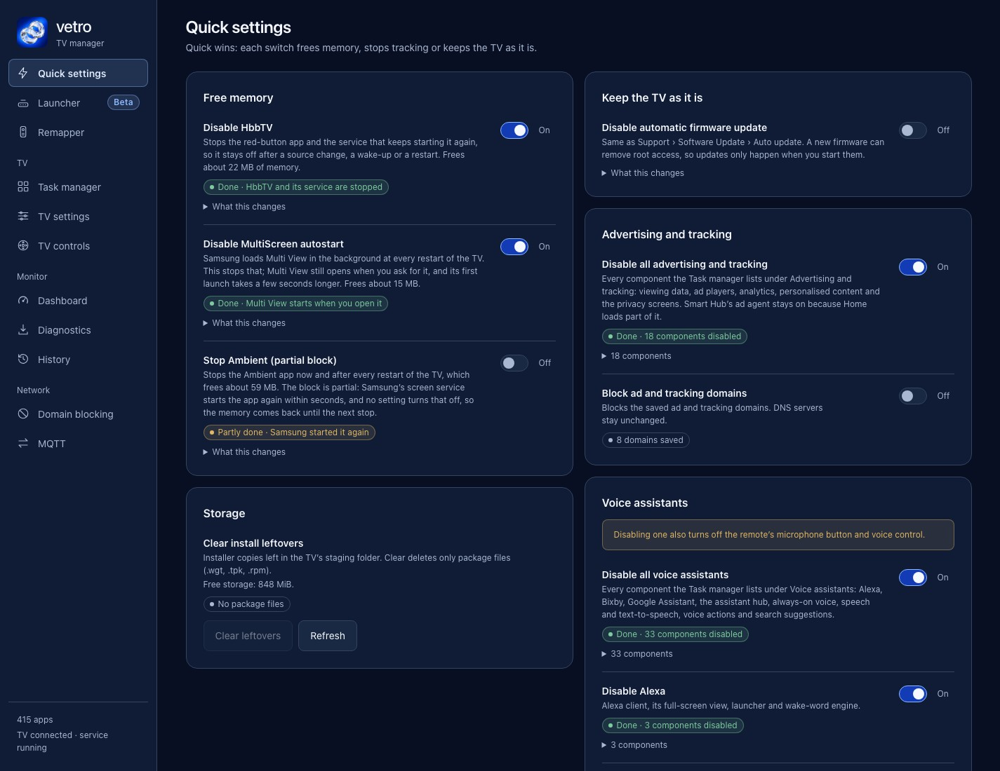
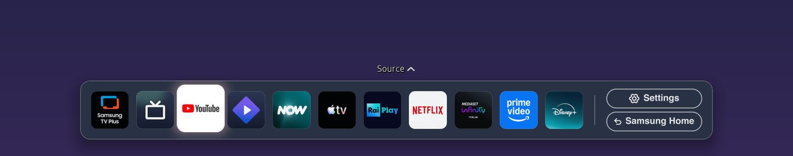
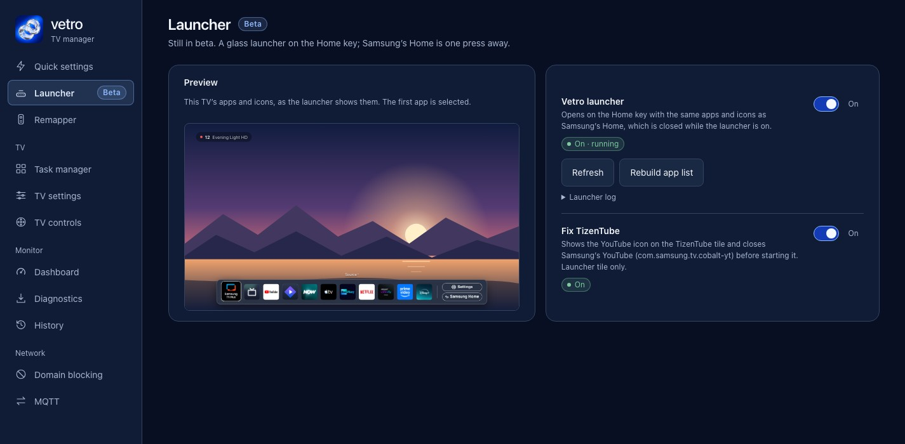
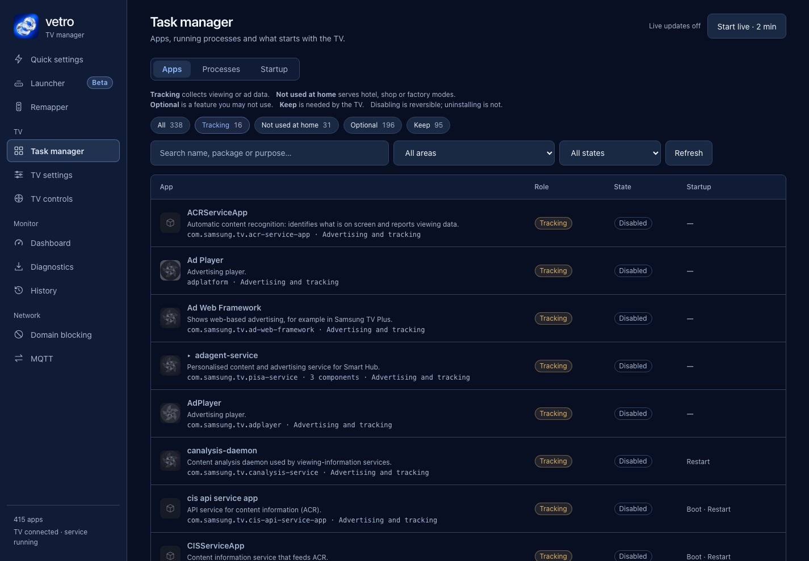
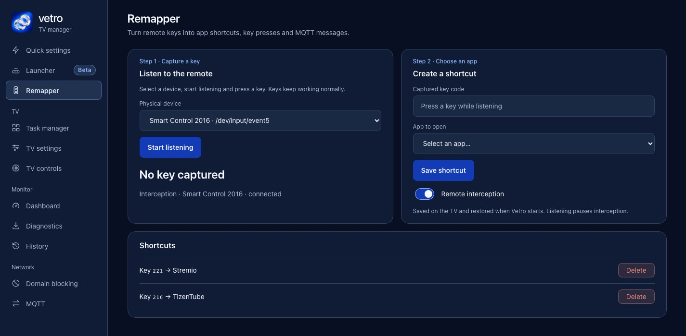

<p align="center">
  
</p>
<h1 align="center">Vetro</h1>
<p align="center"><strong>Launcher. Debloater. Remapper.<br>The all-in-one TV manager for Samsung Tizen.</strong></p>
<p align="center">Take control of your TV: get your privacy and your performance back.</p>
<p align="center">
  <a href="#launcher">Launcher</a> ·
  <a href="#debloater">Debloater</a> ·
  <a href="#remapper">Remapper</a> ·
  <a href="app/docs/INSTALLATION.md">Install</a> ·
  <a href="#compatibility">Compatibility</a>
</p>

Vetro runs on your Samsung TV with root access and gives you a dashboard, open from any computer or phone on your network, to manage it. Replace Samsung's Home with a light launcher, switch off what tracks you and wastes memory, and make the remote do what you want.

<p align="center">
  
  <br><em>The dashboard on a Samsung Q80A.</em>
</p>

## Launcher

A fast, glass-style launcher on the Home key. It shows the same apps and icons as Samsung's Home, in the same order, and comes back by itself after a restart or a standby. Samsung's Home is one press away (the **Samsung Home** button), and nothing is removed.

**It frees memory.** While the launcher is on, Samsung's Home is closed. On the Q80A that is about 150 MB of RAM that the launcher replaces with about 20–30 MB: available RAM went from **533 MB to 662 MB, about 24% more**. Method and numbers in the [performance evidence](app/docs/PERFORMANCE.md).

<p align="center">
  
  <br><em>The launcher as the TV draws it (captured from the Q80A, over a plain backdrop instead of the video).</em>
</p>

Turn it on in the **Launcher** tab, which also previews the bar. **Fix TizenTube** gives that tile the YouTube icon and closes Samsung's YouTube before TizenTube starts. The launcher is in beta.

<p align="center">
  
</p>

## Debloater

Samsung TVs ship with advertising, viewing-data collection, voice assistants and background services you never asked for. Vetro lets you see them and switch them off, and every switch can be turned back on.

**Quick settings** has one switch per win:

- **Disable all advertising and tracking**, which includes the ACR viewing-data services.
- **Block ad and tracking domains** with a filter on the TV itself, keeping your DNS servers.
- **Disable HbbTV** and **MultiScreen autostart**, which free about 22 MB and 15 MB of RAM.
- **Disable all voice assistants**, or Alexa, Google Assistant, Bixby and the other voice services one by one.
- **Disable automatic firmware update**, so a new firmware does not remove root behind your back.

Each switch shows *Done* or *Partly done*, so you can see what actually changed. Turning voice off also turns off the remote's microphone button; Vetro asks you to confirm. Domain filtering does not guarantee that every app's ads or telemetry are blocked.

**Task manager** lists every app and service on the TV (338 on the Q80A) with a plain description and a role: **Tracking**, **Not used at home**, **Optional** or **Keep**. Search by name, package or purpose, then disable, stop or uninstall with an in-page confirmation. Protected system components cannot be touched.

<p align="center">
  
  <br><em>Find viewing analytics and advertising components without guessing what they do.</em>
</p>

Quick settings and Task manager share the same inventory: disable an assistant in one and its components show up as disabled in the other. Disabling a component keeps it installed and can be reversed; stopping ends the running process; uninstalling needs an installer to recover. Descriptions come from the Q80A's firmware, so on other models some packages are unclassified and left alone.

## Remapper

Do what you want with the remote. Press a button, choose an app, and the button opens it. Shortcuts survive restarts, and a key can also trigger an MQTT message for Home Assistant.

<p align="center">
  
</p>

## Also included

- **TV settings:** adjust supported picture controls and selected advanced settings, with read-back and restore.
- **MQTT and Home Assistant:** publish the TV's state and discovery and trigger actions from exact topics. [Setup guide](app/docs/mqtt/README.md).
- **Dashboard:** CPU, RAM, swap, storage and processes. Live sampling starts when you ask and stops after two minutes.
- **Diagnostics:** download a redacted report to share in an issue. [Report format](app/docs/DIAGNOSTIC-EXPORT.md).

## Install

Vetro needs root on the TV. There are three ways to install it:

- **1. Apps2Samsung (the fastest).** Vetro is in the catalog of [Apps2Samsung](https://github.com/Apps2Samsung/Apps2Samsung), the one-click installer for Samsung TVs by [PatrickSt1991](https://github.com/PatrickSt1991). It handles the certificate, the signing and the install for you. Thanks, Patrick!
- **2. With a coding agent.** Let an AI coding agent with a terminal (for example Codex or Gemini CLI) follow the guide for you. Not Claude: its cybersecurity safeguards stop it on the root steps.
- **3. Manual.** Tizen Studio, your own Samsung certificate, build, sign and install, step by step.

Whichever way you choose, finish with the same two steps: **open Vetro once** on the TV, then set **Host PC IP** to `127.0.0.1` in Developer Mode and restart the TV. [Full guide for all three ways →](app/docs/INSTALLATION.md)

The root comes from [Chris Ritsen's Samsung TV root research](https://github.com/chris-ritsen/samsung-tv-root) and works through TV-local SDB, so no computer needs to stay connected. Startup can take up to 90 seconds. This is experimental software: privileged changes can disrupt TV features, so read what a switch does before turning it on.

**The dashboard uses plain HTTP and has no login.** Anyone on your network can open it, so keep the TV on a trusted LAN and never expose it to the Internet. [Integration details](rooting/README.md) · [Validation record](app/docs/RELEASE-AUDIT.md)

## Compatibility

Vetro is developed and tested on a **Samsung Q80A**, and community reports confirm it on the other models below. Each report comes with a diagnostic export showing the app, the service and the root agent running, and the reporter's own account of what works.

| TV | Firmware | Status |
| --- | --- | --- |
| **Q80A** QE50Q80AATXZT (2021) | T-NKM2DEUC-2301.1 | **Developed and tested here** |
| Q70A QE55Q70AATXXC (2021) · [#8](https://github.com/andrearicci93/vetro/issues/8) | T-NKM2DEUC-2301.1 | Reported working |
| Q60A QN70Q60AAVXZC (2021) · [#28](https://github.com/andrearicci93/vetro/issues/28) | T-NKLAAKUC-2310.0 | Reported working; the listen port was changed to avoid a clash with tizen-youtube |
| QN85A GQ65QN85AATXZG (2021) | T-NKM2DEUC-2301.1 | Reported working, back after a reboot |
| Q67B QE43Q67BAUXXH (2022) | T-NKLBDEUC-1720.7 | Reported working |
| UE65BU8002KXXH (2022) · [#22](https://github.com/andrearicci93/vetro/issues/22) | T-KSU2EBDEUC-1720.7 | Reported working; the Launcher needed the 0.3.1 fix for the Home cache folder |
| QE75QN85BATXXU (2022) · [#25](https://github.com/andrearicci93/vetro/issues/25) | 1720.7 | Core functions reported working; the Launcher failed before 0.3.1 (Home cache folder) |
| QN55S95B QN55S95BAFXZA (2022) · [#14](https://github.com/andrearicci93/vetro/issues/14) | T-PTMAKUC-1720.7 | Reported working |
| Q65S95C (2023) · [#13](https://github.com/andrearicci93/vetro/issues/13) | T-PTMCDEUC-0090-2220.4 | Reported working |
| GU75CU7179 (2023, Tizen 9.0) · [#17](https://github.com/andrearicci93/vetro/issues/17) | Tizen 9.0 (23_KSUE_UB_T09) | Reported working, installed with Apps2Samsung |
| QN55Q65D QN55Q65DAGXZS (2024) · [#10](https://github.com/andrearicci93/vetro/issues/10) | T-NKLDUABC-0090-2123.9 | Reported working, installed with Apps2Samsung |
| S90C TQ65S90CATXXC (2023, Tizen 7.0) · [#16](https://github.com/andrearicci93/vetro/issues/16) | T-PTMCDEUC-2000.2 | Reported working |
| S90D QA65S90DAULXL (2024, Tizen 9) · [#36](https://github.com/andrearicci93/vetro/issues/36) | T-PTMDUABC-0090-2130.0 | Reported working, with the root agent back after a full restart (the owner's account) |
| LS03B QN75LS03BAFXZA (The Frame, 2022) · [#39](https://github.com/andrearicci93/vetro/issues/39) | T-PTMAKUC-1720.7 | Reported working, the service started by itself after a cold boot; the Launcher was not tried |
| Smart Monitor M8 LS32BM801UNXGO · [#15](https://github.com/andrearicci93/vetro/issues/15) | T-PTMWWC-1720.7 | Installed, service and root agent running; what works not reported yet |
| Q80R QN65Q80RAFXZA (2019, Tizen 5.0) · [#35](https://github.com/andrearicci93/vetro/issues/35) | T-MSMAKUC-1500.5 | Works with **local changes**, not with the stock package: a personal port with its own launcher host, app registry paths and Node.js 16.20.2, not reviewed or merged |
| UE43NU7090 (2018, Tizen 4) · [#2](https://github.com/andrearicci93/vetro/issues/2) | 1400.2 | Not working so far |

Not tried with Vetro: the QN90B and QN90F, where the upstream root route has been demonstrated, and any other Tizen TV. Tizen 6 or newer is what has worked with the stock package (one Tizen 5 TV works with a local port); there is no confirmed range, and firmware updates can change the result even within one model family.

**Add your TV.** Open a [diagnostic report issue](https://github.com/andrearicci93/vetro/issues/new?template=log_report.yml) with your exact model and firmware, what worked or failed, and the report from **Diagnostics → Download**. The report excludes credentials, IP and MAC addresses, serial numbers and viewing history; read it before you upload it. Failed attempts help too.

## Development

The app has no npm runtime dependencies. Use a maintained Node.js release and Python 3.10+ for repository checks.

```sh
git clone https://github.com/andrearicci93/vetro.git
cd vetro/app
npm test
npm start
```

Open `http://127.0.0.1:8099/`. Local mode serves the UI with device operations unavailable; it does not simulate a connected TV. The separate [integration builder](rooting/README.md) adds the TV adapter and runtime payloads to the app package. If the app reports that the TV platform adapter is unavailable, you installed the app-only package: see [troubleshooting](app/docs/INSTALLATION.md#if-the-dashboard-says-the-root-agent-is-not-connected) (section "If the dashboard says the root agent is not connected" in `app/docs/INSTALLATION.md`).

From the repository root, run the remaining checks:

```sh
node rooting/tests/run.cjs
python3 .github/scripts/test_parse_log.py
python3 .github/scripts/audit_release.py
```

[App & platform contract](app/README.md) · [Contributing](CONTRIBUTING.md) · [Security](SECURITY.md) · [Changelog](CHANGELOG.md)

## Contributors

Thanks to the people who contributed code and documentation to Vetro:

- [tomcraft](https://github.com/tomcraft): direct TV-tuner key, and the remote found again after a restart ([#31](https://github.com/andrearicci93/vetro/pull/31), [#32](https://github.com/andrearicci93/vetro/pull/32)).
- [SalustLab](https://github.com/SalustLab): the service on Node 4.4, app-only ([#33](https://github.com/andrearicci93/vetro/pull/33)).
- [domenix](https://github.com/domenix): start at boot when the installer ignores the package flags, S90C compatibility details, app IDs for repeated names ([#27](https://github.com/andrearicci93/vetro/pull/27), [#29](https://github.com/andrearicci93/vetro/pull/29), [#52](https://github.com/andrearicci93/vetro/pull/52)).
- [bertrandom](https://github.com/bertrandom): Tizen Studio links in the installation guide ([#47](https://github.com/andrearicci93/vetro/pull/47)).
- [PatrickSt1991](https://github.com/PatrickSt1991): Apps2Samsung credit ([#21](https://github.com/andrearicci93/vetro/pull/21)).

People who reported problems or shared results from their TVs are credited in the [changelog](CHANGELOG.md).

## Credits & license

Vetro builds on [Chris Ritsen and contributors' Samsung TV root research](https://github.com/chris-ritsen/samsung-tv-root). [Glasshouse](https://github.com/rorygallagher2024/glasshouse) inspired the TV-management concept and dashboard. [TizenBrew, TizenTube and tizen.js](https://github.com/reisxd) informed installation and runtime research; [Samsung's developer documentation](https://developer.samsung.com/smarttv/develop/getting-started/using-sdk/tv-device.html) documents the device workflow. The install-leftovers cleanup is ported from [Apps2Samsung](https://github.com/Apps2Samsung/Apps2Samsung), which is also the recommended way to install Vetro. See [third-party notices](THIRD_PARTY_NOTICES.md) for provenance and licenses.

Original Vetro code is [MIT licensed](LICENSE); vendored code retains its own license. Independent, experimental software, provided as is and unaffiliated with Samsung or the projects above. Generative AI and coding agents assisted development; tests and device observations define what has been verified.

### Direct physical Home interception

When the Launcher is enabled and physical remote interception is active in
Remapper, physical Home is sent directly to the launcher's command FIFO instead
of reaching Samsung first. It uses the existing Launcher on/off setting: there
is no extra switch or marker to create. A configured physical Home remapping takes
priority. SmartThings and other network remotes keep the existing Home handling.

This reuses the existing physical remapping filter; it does not select or grab an
unconfigured remote automatically. If that filter is inactive, the launcher keeps
its existing Home handling. The saved launcher state must explicitly contain
`"enabled": true`; missing, invalid or disabled state leaves Home unchanged.

If the launcher FIFO has no reader, is full, is not a FIFO, or cannot be validated,
Home is forwarded normally. Descriptor validation uses Linux `statx` (kernel 4.11
and libc 2.28 or newer); on systems where it is unavailable the helper forwards
Home. FIFO write success means the command was queued, not acknowledged by the
launcher: an unresponsive launcher that keeps its FIFO open is not detected.
