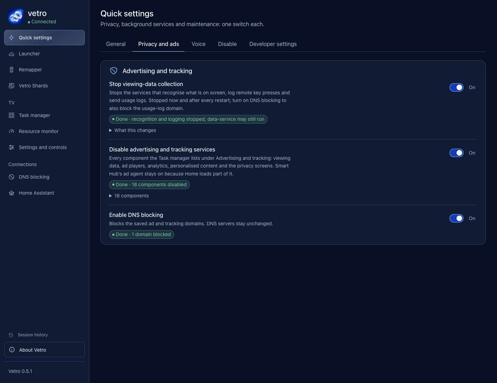
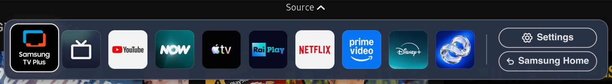
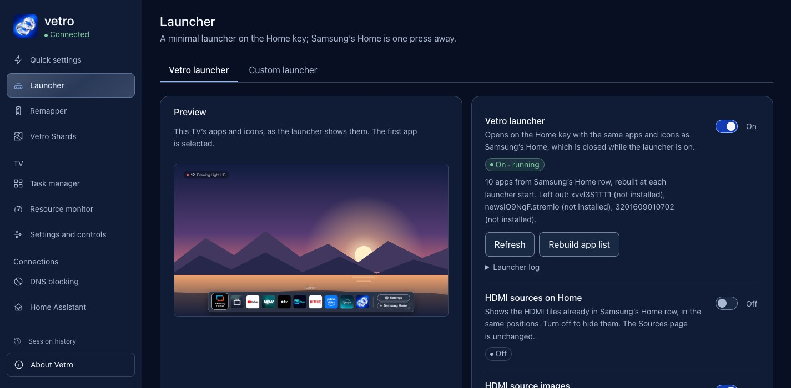
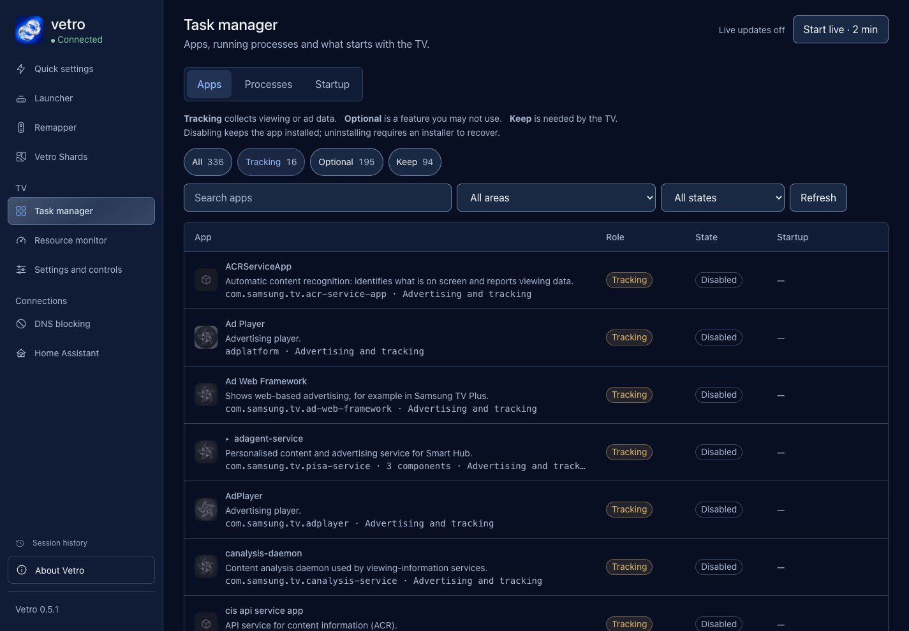
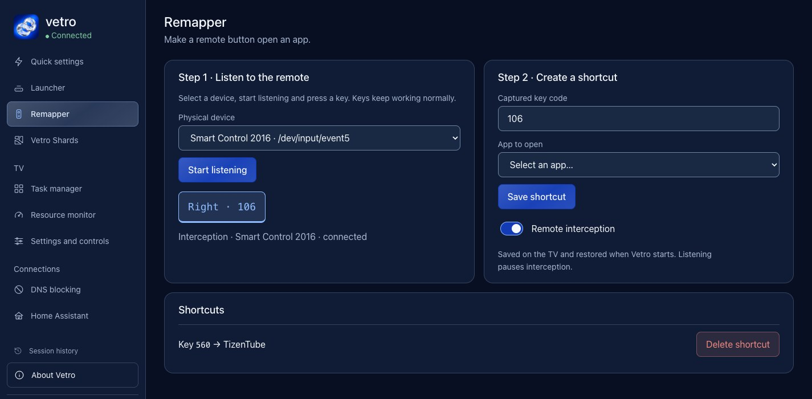

<p align="center">
  
</p>
<h1 align="center">Vetro</h1>
<p align="center"><strong>Launcher. Debloater. Remapper.<br>The all-in-one TV manager for Samsung Tizen.</strong></p>
<p align="center">Manage your Samsung TV from a browser: a minimal launcher, privacy switches and remote shortcuts.</p>
<p align="center">
  <a href="#launcher">Launcher</a> ·
  <a href="#debloater">Debloater</a> ·
  <a href="#remapper">Remapper</a> ·
  <a href="app/docs/INSTALLATION.md">Install</a> ·
  <a href="#compatibility">Compatibility</a> ·
  <a href="https://discord.gg/Pe9BmthUar">Discord</a>
</p>

Vetro runs on your Samsung TV and gives you a dashboard, open from any computer or phone on your network. Replace Samsung's Home with a minimal launcher, switch off what tracks you and wastes memory, and make the remote open the apps you want. It needs root access on the TV and works on **Tizen 6 or newer** (2021 TVs and later); older TVs get the dashboard and diagnostics only. See [Compatibility](#compatibility).

<p align="center">
  
  <br><em>Quick settings in the Vetro dashboard.</em>
</p>

## Launcher

A fast, minimal launcher on the Home key. It shows the same apps and icons as Samsung's Home, in the same order, and comes back by itself after a restart or a standby. Samsung's Home is one press away (the **Samsung Home** button), and nothing is removed.

**It frees memory.** Samsung's Home is closed while the launcher is on. On a Q80A, available RAM went up by about 24% (533 MB to 662 MB); other TVs will differ. Method and numbers in the [performance evidence](app/docs/PERFORMANCE.md).

<p align="center">
  
  <br><em>The launcher on the TV.</em>
</p>

Turn it on in the **Launcher** tab, which also previews the bar. Optional switches: **Reduce motion**, **Fix TizenTube** (YouTube icon on the TizenTube tile), **HDMI sources on Home** and **HDMI source images**. Prefer another app on the Home key? **Custom launcher** opens any installed app instead.

<p align="center">
  
</p>

## Debloater

Samsung TVs ship with advertising, viewing-data collection, voice assistants and background services you never asked for. Vetro lets you see them and switch them off, and every switch can be turned back on.

**Quick settings** groups common privacy and background-service switches:

- **Disable advertising and tracking services**, including the viewing-recognition (ACR) services.
- **Enable DNS blocking** with a filter on the TV itself, keeping your DNS servers.
- **Stop viewing-data collection**, which stops the services that recognise what is on screen, log remote key presses and send usage logs, now and after every restart.
- **Disable HbbTV**, **Multi View autostart**, **Stop Ambient** and **Disable AirPlay** stop background services and free memory. They sit in the **Disable** tab. **Keep removed apps removed**, in General, is on by default: it keeps apps you remove with the Task manager off the TV. Select **Allow again** before reinstalling one yourself.
- **Disable all voice assistants**, or Alexa, Google Assistant, Bixby and the other voice services one by one.
- **Disable automatic firmware update**, so a new firmware does not remove root behind your back.

Each switch shows *Done* or *Partly done*, so you can see what actually changed. Turning voice off also turns off the remote's microphone button; Vetro asks you to confirm. Domain filtering does not guarantee that every app's ads or telemetry are blocked.

**Task manager** lists every app and service on the TV with a plain description and a role: **Tracking**, **Optional** or **Keep**. Search by name, package or purpose, then disable, stop or uninstall with an in-page confirmation. Protected system components cannot be touched. Hotel, shop and factory apps open only after a warning, and never from a remapper, MQTT or HTTP rule; the factory colour test (AgingApp) and the service menu are never opened. If the colour test was left on, Quick settings offers to turn it off.

<p align="center">
  
  <br><em>Find viewing analytics and advertising components without guessing what they do.</em>
</p>

Quick settings and Task manager share the same inventory: disable an assistant in one and its components show up as disabled in the other. Disabling a component keeps it installed and can be reversed; stopping ends the running process; uninstalling needs an installer to recover. Descriptions cover the common Samsung packages; anything unrecognised is left alone.

**Uninstalling:** *Quick settings, Maintenance, Restore the TV* shows the changes Vetro recorded and puts them back after one confirmation. Uninstalled apps, settings without a saved previous value and changes made by plugins need manual recovery. *Remove Vetro* can then delete Vetro's saved data and explains how to delete the app (from the TV's Apps screen, or with Apps2Samsung). [Steps →](app/docs/INSTALLATION.md#uninstalling)

## Remapper

Do what you want with the remote. Press a button, choose an app, and the button opens it. Shortcuts survive restarts, and the Home Assistant page can also turn a key press into an MQTT message.

<p align="center">
  
</p>

## Also included

- **Settings and controls:** change supported picture and advanced settings, check the value the TV saved, restore saved values and send remote keys to the TV.
- **MQTT and Home Assistant:** connect through an MQTT broker to show the TV's sensors and controls in Home Assistant and trigger actions from matching message topics. [Setup guide](app/docs/mqtt/README.md).
- **Dashboard:** CPU, RAM, swap, storage and processes. Live sampling starts when you ask and stops after two minutes.
- **Vetro Shards (plugins):** Vetro’s plugin system, with add-ons written by other people, installed from a public list or a file, off until you switch them on. They are third-party code, not sandboxed (a plugin can do what Vetro can, including running commands as root) and only spot-checked: read the warning in [the plugin guide](app/docs/plugins.md), which also explains how to write and publish one.
- **Updates:** update Vetro from the dashboard, launcher included, with no computer and no reinstall. Updates are signed, and the previous version is restored if the new one does not start. [How it works](app/docs/UPDATING.md).
- **Diagnostics:** download a redacted report to share in an issue. [Report format](app/docs/DIAGNOSTIC-EXPORT.md).

## Install

Vetro needs root on the TV. There are three ways to install it:

- **1. Apps2Samsung (the fastest).** Vetro is in the catalog of [Apps2Samsung](https://github.com/Apps2Samsung/Apps2Samsung), the one-click installer for Samsung TVs by [PatrickSt1991](https://github.com/PatrickSt1991). It handles the certificate, the signing and the install for you. Thanks, Patrick!
- **2. With a coding agent.** Let an AI coding agent with a terminal (for example Codex or Gemini CLI) follow the guide for you. Not Claude: its cybersecurity safeguards stop it on the root steps.
- **3. Manual.** Tizen Studio, your own Samsung certificate, build, sign and install, step by step.

Whichever way you choose, finish with the same two steps: **open Vetro once** on the TV, then set **Host PC IP** to `127.0.0.1` in Developer Mode and restart the TV. [Full guide for all three ways →](app/docs/INSTALLATION.md)

The root comes from [Chris Ritsen's Samsung TV root research](https://github.com/chris-ritsen/samsung-tv-root) and works through TV-local SDB, so no computer needs to stay connected. Startup time varies by TV; wait for the status shown in the Vetro app. This is experimental software: privileged changes can disrupt TV features, so read what a switch does before turning it on.

**Pairing is automatic by default:** once the Vetro app on the TV has been seen, every browser or script pairs once with a 6-digit code shown on the TV; until then (and on a TV whose app is never recognised) the dashboard is open like 0.3.5 and says so. **Require pairing** in Developer settings lets you force it on or off ([sign-in](app/docs/SIGN-IN.md)). Traffic is plain HTTP, so keep the TV on a trusted LAN and never expose it to the Internet. [Integration details](rooting/README.md) · [Validation record](app/docs/RELEASE-AUDIT.md)

## Compatibility

Vetro is developed on a **Samsung Q80A**; everything else below comes from community reports. Find your Tizen version under **Settings › Support › About this TV**. The model year only gives a hint, and a firmware update can change the result.

| Tizen (typical year) | Dashboard, app list, diagnostics | Root features (launcher, privacy switches, remapper) | Reports |
| --- | --- | --- | --- |
| **9 and 10** (2024–2025) | Reported working | Reported working on some TVs; some TVs block apps from reaching the service on the TV itself ([#122](https://github.com/andrearicci93/vetro/issues/122), fallback in 0.5.0 not yet tried), and root problems are reported on others ([#91](https://github.com/andrearicci93/vetro/issues/91), [#99](https://github.com/andrearicci93/vetro/issues/99)) | S90D, GU75CU7179 |
| **7 and 8** (2023–2024) | Reported working | Reported working | S90C, S95C, Q65D |
| **6.5** (2022) | Reported working | Reported working (the launcher needs Vetro 0.3.1 or newer) | Q67B, QN85B, S95B, BU8002, The Frame |
| **6** (2021) | Reported working | Reported working; one TV needs the Host PC IP step to be confirmed ([#134](https://github.com/andrearicci93/vetro/issues/134)) | Q80A, Q70A, Q60A, QN85A, AU7000 |
| **5.5** (2020) | Reported working | Not available | TU7090, T4300 |
| **5.0** (2019) | Not with the stock package | One Q80R works with a personal port ([#35](https://github.com/andrearicci93/vetro/issues/35)) | Q80R |
| **4** (2018) | Reported working | Not available | NU7090 |

Not tried with Vetro: the QN90B and QN90F, where the upstream root route has been demonstrated, and any other Tizen TV. There is no confirmed range outside what is listed.

<details>
<summary>Reports by model</summary>

| TV | Firmware | Status |
| --- | --- | --- |
| **Q80A** QE50Q80AATXZT (2021) | T-NKM2DEUC-2301.1 | **Developed and tested here** |
| Q70A QE55Q70AATXXC (2021) · [#8](https://github.com/andrearicci93/vetro/issues/8) | T-NKM2DEUC-2301.1 | Reported working |
| Q60A QN70Q60AAVXZC (2021) · [#28](https://github.com/andrearicci93/vetro/issues/28) | T-NKLAAKUC-2310.0 | Reported working; the listen port was changed to avoid a clash with tizen-youtube |
| QN85A GQ65QN85AATXZG (2021) | T-NKM2DEUC-2301.1 | Reported working, back after a reboot |
| Q67B QE43Q67BAUXXH (2022) | T-NKLBDEUC-1720.7 | Reported working |
| UE65BU8002KXXH (2022) · [#22](https://github.com/andrearicci93/vetro/issues/22) | T-KSU2EBDEUC-1720.7 | Reported working; the Launcher needed the 0.3.1 fix for the Home cache folder |
| QE75QN85BATXXU (2022) · [#25](https://github.com/andrearicci93/vetro/issues/25) | 1720.7 | Core functions reported working; the Launcher failed before 0.3.1 (Home cache folder) |
| QN55S95B QN55S95BAFXZA (2022) · [#14](https://github.com/andrearicci93/vetro/issues/14) | T-PTMAKUC-1720.7 | Reported working |
| Q65S95C (2023) · [#13](https://github.com/andrearicci93/vetro/issues/13) | T-PTMCDEUC-0090-2220.4 | Reported working |
| GU75CU7179 (2023, Tizen 9.0) · [#17](https://github.com/andrearicci93/vetro/issues/17) | Tizen 9.0 (23_KSUE_UB_T09) | Reported working, installed with Apps2Samsung |
| QN55Q65D QN55Q65DAGXZS (2024) · [#10](https://github.com/andrearicci93/vetro/issues/10) | T-NKLDUABC-0090-2123.9 | Reported working, installed with Apps2Samsung |
| S90C TQ65S90CATXXC (2023, Tizen 7.0) · [#16](https://github.com/andrearicci93/vetro/issues/16) | T-PTMCDEUC-2000.2 | Reported working |
| S90D QA65S90DAULXL (2024, Tizen 9) · [#36](https://github.com/andrearicci93/vetro/issues/36) | T-PTMDUABC-0090-2130.0 | Reported working, with the root agent back after a full restart (the owner's account) |
| LS03B QN75LS03BAFXZA (The Frame, 2022) · [#39](https://github.com/andrearicci93/vetro/issues/39) | T-PTMAKUC-1720.7 | Reported working, the service started by itself after a cold boot; the Launcher was not tried |
| Smart Monitor M8 LS32BM801UNXGO · [#15](https://github.com/andrearicci93/vetro/issues/15) | T-PTMWWC-1720.7 | Installed, service and root agent running; what works not reported yet |
| Q80R QN65Q80RAFXZA (2019, Tizen 5.0) · [#35](https://github.com/andrearicci93/vetro/issues/35) | T-MSMAKUC-1500.5 | Works with **local changes**, not with the stock package: a personal port with its own launcher host, app registry paths and Node.js 16.20.2, not reviewed or merged |
| UA50AU7000 UA50AU7000UXTW (2021, Tizen 6) · [#134](https://github.com/andrearicci93/vetro/issues/134) | T-KSU2EUABC-2310.0 | Service and dashboard reported working; the root agent did not connect (the Host PC IP step was not confirmed), so the features that need it stay off |
| UE43TU7090 UE43TU7090UXZT (2020) · [#132](https://github.com/andrearicci93/vetro/issues/132) | T-KTSU2DEUC-2501.1 | Dashboard, app list and diagnostics reported working; features that need root access are unavailable |
| UN32T4300 UN32T4300AGXZD (2020) · [#128](https://github.com/andrearicci93/vetro/issues/128) | T-KTS2UABC-2743.0 | Dashboard, app list and diagnostics reported working; features that need root access are unavailable |
| UE43NU7090 (2018, Tizen 4) · [#2](https://github.com/andrearicci93/vetro/issues/2) | 1400.2 | Dashboard, app list and diagnostics reported working; features that need root access are unavailable |

</details>

**Add your TV.** Open a [diagnostic report issue](https://github.com/andrearicci93/vetro/issues/new?template=log_report.yml) with your exact model and firmware, what worked or failed, and the report from **Quick settings → Developer settings → Diagnostic report**. The report excludes credentials, IP and MAC addresses, serial numbers and viewing history; read it before you upload it. Failed attempts help too.

## Community

Questions, ideas or a new TV to report? Join the [Vetro Discord](https://discord.gg/Pe9BmthUar), or open an [issue](https://github.com/andrearicci93/vetro/issues).

## Development

The app has no npm runtime dependencies. Use a maintained Node.js release and Python 3.10+ for repository checks.

```sh
git clone https://github.com/andrearicci93/vetro.git
cd vetro/app
npm test
npm start
```

Open `http://127.0.0.1:8099/`. Local mode serves the UI with device operations unavailable; it does not simulate a connected TV. The separate [integration builder](rooting/README.md) adds the TV adapter and runtime payloads to the app package. If the app reports that the TV platform adapter is unavailable, you installed the app-only package: see [troubleshooting](app/docs/INSTALLATION.md#if-the-dashboard-says-the-root-agent-is-not-connected) (section "If the dashboard says the root agent is not connected" in `app/docs/INSTALLATION.md`).

From the repository root, run the remaining checks:

```sh
node rooting/tests/run.cjs
python3 .github/scripts/test_parse_log.py
python3 .github/scripts/audit_release.py
```

[App & platform contract](app/README.md) · [Contributing](CONTRIBUTING.md) · [Security](SECURITY.md) · [Changelog](CHANGELOG.md)

## Contributors

Thanks to the people who contributed code and documentation to Vetro (including adapted work whose PR is still open):

- [zerodevb](https://github.com/zerodevb): dashboard and API pairing sign-in ([#9](https://github.com/andrearicci93/vetro/pull/9)).
- [Firaenix](https://github.com/Firaenix): CoBA multi-app Home guard, still selection, raw navigation and delayed Home echoes, adapted into the bundled launcher ([#23](https://github.com/andrearicci93/vetro/pull/23), [#24](https://github.com/andrearicci93/vetro/pull/24)).
- [pponce](https://github.com/pponce/vetro): remote input and queued actions are cancelled when the service stops ([#138](https://github.com/andrearicci93/vetro/issues/138)).
- [zabique](https://github.com/zabique/vetro) (branch `fork/extras`): the ideas and first implementations of Keep removed apps removed, Disable AirPlay, the restart check after a snapshot boot and stopping the HbbTV service app, re-written for Vetro.
- [skjnldsv](https://github.com/skjnldsv): measured that The Frame 2025 (Tizen 9) blocks loopback for apps and proposed reaching the service through the TV's own address ([#122](https://github.com/andrearicci93/vetro/issues/122), [#123](https://github.com/andrearicci93/vetro/pull/123)); adapted for the sign-in. Not tried on a TV yet.
- [Merennor](https://github.com/Merennor): Node 4.4 compatibility for the integration adapter and unsupported-root fallback on Tizen 4 ([#75](https://github.com/andrearicci93/vetro/pull/75)).

- [tomcraft](https://github.com/tomcraft): direct TV-tuner key, and the remote found again after a restart ([#31](https://github.com/andrearicci93/vetro/pull/31), [#32](https://github.com/andrearicci93/vetro/pull/32)).
- [SalustLab](https://github.com/SalustLab): the service on Node 4.4, app-only ([#33](https://github.com/andrearicci93/vetro/pull/33)).
- [domenix](https://github.com/domenix): start at boot when the installer ignores the package flags, S90C compatibility details, app IDs for repeated names ([#27](https://github.com/andrearicci93/vetro/pull/27), [#29](https://github.com/andrearicci93/vetro/pull/29), [#52](https://github.com/andrearicci93/vetro/pull/52)).
- [bertrandom](https://github.com/bertrandom): Tizen Studio links in the installation guide ([#47](https://github.com/andrearicci93/vetro/pull/47)).
- [PatrickSt1991](https://github.com/PatrickSt1991): Apps2Samsung credit ([#21](https://github.com/andrearicci93/vetro/pull/21)).

People who reported problems or shared results from their TVs are credited in the [changelog](CHANGELOG.md).

## Credits & license

Vetro builds on [Chris Ritsen and contributors' Samsung TV root research](https://github.com/chris-ritsen/samsung-tv-root), including runtime detection and compatibility checks adapted from [v0.0.12](https://github.com/chris-ritsen/samsung-tv-root/releases/tag/v0.0.12) under the Unlicense. [Glasshouse](https://github.com/rorygallagher2024/glasshouse) inspired the TV-management concept and dashboard. [TizenBrew, TizenTube and tizen.js](https://github.com/reisxd) informed installation and runtime research; [Samsung's developer documentation](https://developer.samsung.com/smarttv/develop/getting-started/using-sdk/tv-device.html) documents the device workflow. The install-leftovers cleanup is ported from [Apps2Samsung](https://github.com/Apps2Samsung/Apps2Samsung), which is also the recommended way to install Vetro. See [third-party notices](THIRD_PARTY_NOTICES.md) for provenance and licenses.

Original Vetro code is [MIT licensed](LICENSE); vendored code retains its own license. Independent, experimental software, provided as is and unaffiliated with Samsung or the projects above. Generative AI and coding agents assisted development; tests and device observations define what has been verified.

### Direct physical Home interception

When the Launcher is enabled and physical remote interception is active in
Remapper, physical Home is sent directly to the launcher's command FIFO instead
of reaching Samsung first. It uses the existing Launcher on/off setting: there
is no extra switch or marker to create. A configured physical Home remapping takes
priority. SmartThings and other network remotes keep the existing Home handling.

This reuses the existing physical remapping filter; it does not select or grab an
unconfigured remote automatically. If that filter is inactive, the launcher keeps
its existing Home handling. The saved launcher state must explicitly contain
`"enabled": true`; missing, invalid or disabled state leaves Home unchanged.

If the launcher FIFO has no reader, is full, is not a FIFO, or cannot be validated,
Home is forwarded normally. Descriptor validation uses Linux `statx` (kernel 4.11
and libc 2.28 or newer); on systems where it is unavailable the helper forwards
Home. FIFO write success means the command was queued, not acknowledged by the
launcher: an unresponsive launcher that keeps its FIFO open is not detected.
