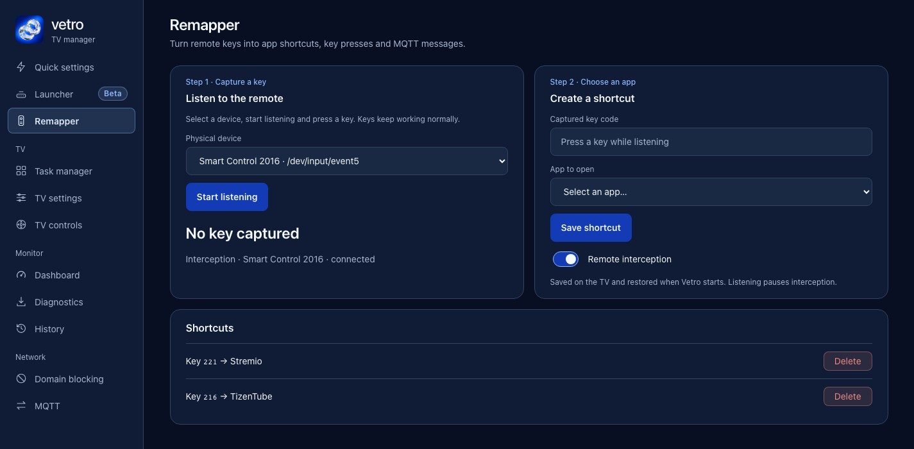

The Netflix, Prime Video and similar buttons on a Samsung Smart Remote cannot be reassigned in the TV's settings. A Samsung community moderator said as much in a 2022 thread: "there is no Samsung way to reprogram or deactivate the buttons." On a rooted TV, Vetro's Remapper does it: you press a key, pick an app, save, and the key opens that app instead. Vetro is experimental, needs root and ships no signed installer; see [Vetro's root requirements](/root/how-to-root-samsung-tv/) and the [Apps2Samsung install guide](/root/install-vetro-apps2samsung/) first. This page covers what the stock TV offers, what the Remapper does and where it stops.

## Can you remap the buttons with Samsung's own settings?

No. In [Samsung's community thread on the shortcut buttons](https://community.samsung.com/us/conversations/QLED-and-The-Frame/Shortcut-buttons-on-smart-remote/us_2184600), a Samsung moderator answered on 9 February 2022 that there is no Samsung way to reprogram or deactivate them. Other posters suggested pairing an older remote that lacks the streaming buttons, covering the buttons physically, or using Android apps such as Button Mapper. The last is a request to Samsung rather than a confirmed option for Tizen.

Without root, the options in that thread come down to a different remote or living with the buttons. Menu names and what the remote exposes differ by model and year, so check your own TV before assuming the thread applies.

## What does the Vetro Remapper do?

Vetro runs on the TV and serves a dashboard you open from a computer or phone on the same network. The Remapper tab works like this:

1. Start listening and press the button on the remote.
2. Choose what it should do, for example open an app.
3. Save the shortcut.

The [README](https://github.com/andrearicci93/vetro/blob/main/README.md) says shortcuts survive restarts. The [CHANGELOG](https://github.com/andrearicci93/vetro/blob/main/CHANGELOG.md) adds that saved remaps are written so a power cut is much less likely to corrupt them, and the [release audit](https://github.com/andrearicci93/vetro/blob/main/app/docs/RELEASE-AUDIT.md) records that the saved on or off choice for physical remote interception is restored after a service restart. The documented rule actions are opening an app and sending a supported native remote key. The Home Assistant page can also turn a key press into an MQTT message, which is the route to [Home Assistant](/control/samsung-remote-keys-home-assistant/).

On the [Q80A](/tested-tvs/q80a/), in that audit (an earlier build than 0.5.0), the TV was restarted without opening Vetro by hand, the service and root helper came back, both saved key codes were blocked again, and pressing the Prime Video button opened Stremio. That is one TV and two reboots, not a guarantee for every firmware.

## Which keys can I remap?

The README does not list which keys work on which model, and the answer depends on firmware. The Remapper reads the remote's input device on the TV and blocks the original action for the keys you save. What the CHANGELOG documents:

- Vetro 0.3.5 added `KEY_TV` and `XF86DiscretSourceTV` as accepted native keys (a contribution by tomcraft), so a rule can select the tuner instead of cycling through sources. Whether the key exists is firmware-dependent, and on a TV without it the request does nothing.
- A remote that shows several input interfaces under one name used to stay disconnected after a restart. Vetro now picks the interface that advertises keys and, if it cannot decide, leaves interception off instead of guessing.
- While shortcuts are active, keys that keep their normal action work in Tizen's on-screen keyboard (tested on a Q80A).

Try your remote and see what the listening step reports.

## What are the limits?

- Root is required. Vetro ships no signed installer, so you install a package signed for your TV, for example with Apps2Samsung. Read [whether rooting a Samsung TV is safe](/root/is-it-safe-to-root-samsung-tv/) before you start.
- Native key behavior stays until Vetro and its helper are running. In the audit the key filter was seen connected at about 115 and 118 seconds of uptime, and until then the button opens whatever Samsung assigned.
- In the same audit the TizenTube key was blocked and its launch action reported no error, but YouTube opened anyway; TizenTube behavior was not validated. See [TizenTube on a Samsung TV](/control/tizentube-samsung-tv/).
- If a remote action fails, Vetro pauses shortcuts for a minute instead of for good.
- The launcher is in beta and Vetro is developed on the Q80A. Other models are reported in the README's [compatibility table](https://github.com/andrearicci93/vetro/blob/main/README.md#compatibility); the [tested TVs](/tested-tvs/) index links each model page. The stock package offers no root features on Tizen 5.5 or older. The README records one Q80R on Tizen 5.0 working with an unmerged personal port.
- The dashboard runs over plain HTTP. Since 0.5.0, browsers and scripts pair with a six-digit code shown on the TV, but pairing is automatic: until the Vetro app on the TV has been seen, the dashboard is open to the local network. See [SECURITY.md](https://github.com/andrearicci93/vetro/blob/main/SECURITY.md) and the [security model](/reference/vetro-security-model/).

## How do I set up a remap?

This assumes Vetro is already running on a rooted TV. If it is not, start with the [Vetro install guide](/root/install-vetro-apps2samsung/).

1. Open the dashboard from a computer or phone on the same network. The default address is the TV's IP address on port 8099, for example `http://TV_IP:8099/`. If the dashboard asks for a pairing code, it is shown on the TV.
2. Open the Remapper tab and turn on interception of the physical remote. The choice is saved.
3. Start listening, then press the button on the real remote. Listening is temporary and leaving the Remapper tab ends it.
4. Choose the action, save, and press the button again to test it.

Saving is refused if the list of shortcuts changed on the TV since the page loaded, so reload the page if a save fails.

## What happens at boot and in standby?

The key filter needs the Vetro service, the root helper and the interception itself. After a restart Vetro starts them again and restores your saved choice. The audit covers restarts and a reboot on one TV; it states that an unplugged cold boot was not shown, and nothing documented claims a result for standby on every firmware.

## What if a remapped button stops working?

These are the failure modes the project has written down:

- The remote shows several input interfaces. Vetro picks the one that advertises keys; if your shortcuts never fire, check the dashboard's interception status first.
- A key action fails. Shortcuts pause for a minute and then resume.
- A key does nothing. It may not exist on your firmware; the tuner key is the documented example.
- A different remote model may expose different keys. Only the Q80A's remote is documented.

A diagnostic report from the dashboard can be attached to a GitHub issue. The [report format](https://github.com/andrearicci93/vetro/blob/main/app/docs/DIAGNOSTIC-EXPORT.md) lists what it contains; read it before you upload.

## What can a key do beyond opening an app?

It can send a supported native remote key, such as the tuner key above, which gives you a "back to live TV" button. And it can publish an MQTT message so Home Assistant can react to a physical button. The [MQTT guide](https://github.com/andrearicci93/vetro/blob/main/app/docs/mqtt/README.md) covers the broker setup and the TV states Vetro publishes. For the full set of integrations, read [Samsung TV and Home Assistant: three ways](/control/home-assistant-samsung-tv/). Every other switch is listed in [what each Vetro switch changes](/reference/what-each-vetro-switch-changes/).

## Is it worth rooting a TV just to remap a button?

Probably not on its own. You need Developer Mode, a package signed for your TV and a root route that depends on model and firmware, and the compatibility table is built from a small number of community reports. A firmware update can change the result, which is why Vetro has a switch for turning off automatic firmware updates. If one shortcut button is your only complaint, an older remote may cost less than the afternoon you would spend.

It starts to make sense when you also want other things Vetro does, such as switching off viewing-data services, trimming background apps, or sending remote presses to Home Assistant. If you only want a better Home screen, a launcher that needs no root may be enough; [Samsung TV launcher tools compared](/compare/vetro-vs-aerotizen-free-my-tv-tizenbrew/) lists them, and [a custom launcher for a Samsung TV](/speed/custom-launcher-samsung-tv/) covers Vetro's own.

## Without root, is there any other way?

Fewer than you would like. The Samsung thread offers an older remote. For smart-home triggers there is hardware: a Home Assistant community thread about [reading TV remote presses](https://community.home-assistant.io/t/automation-when-press-button-on-tv-remote-control-activate-scene/429272), about an LG TV, suggests an IR receiver on an ESP board. See [Samsung remote keys as Home Assistant events](/control/samsung-remote-keys-home-assistant/).

Next steps: [Jellyfin on a Samsung TV](/control/jellyfin-samsung-tv/) if you want the button to open a media server, and [TizenTube](/control/tizentube-samsung-tv/) for YouTube.
