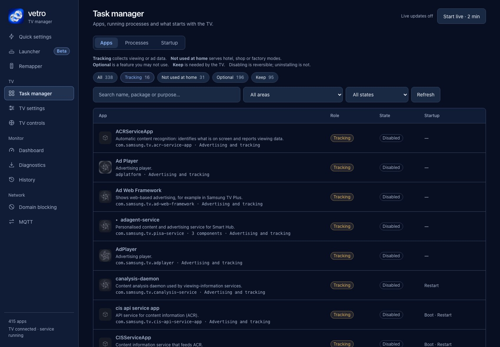

A Samsung smart TV can collect what you watch, identifiers used for advertising, voice recordings if you use voice features, usage and diagnostic logs, and some location information. Which of these happen depends on your model, region and the choices you made at setup. This page lists the categories as Samsung's own notices describe them, then shows where a rooted TV running Vetro lets you see the components behind them.

It is an inventory, not an accusation. A category being listed in a policy does not tell you how much data your TV sends.

## Which categories does Samsung say it collects?

The two primary sources are [Samsung's US privacy policy](https://www.samsung.com/us/account/privacy-policy/) (effective 2026-07-20) and [Samsung Australia's ads notice](https://www.samsung.com/au/info/ads-privacy/) (effective 1 April 2021). The US text we read does not mention "viewing information" or ACR by name, so the viewing-data row relies on the Australian notice. Policies differ by region; check yours.

| Category | What the notice says | Source |
| --- | --- | --- |
| Viewing data | If you agreed to both Interest-Based Advertisement Services and Viewing Information Services, Samsung collects TV viewing history, and "may use automatic content recognition" | Samsung Australia notice |
| Advertising identifiers | Device information for Smart TVs includes the Personalized Service ID and the Tizen Identifier for Advertising. The Australian notice calls the TV identifier a "Personalised Service ID" or PSID | Samsung US policy, Samsung Australia notice |
| Voice | Recordings are collected "when you enable this function" and use voice commands | Samsung US policy |
| Usage and logs | "Diagnostic, technical, error, and usage information", including the time and duration of your use of the Services | Samsung US policy |
| Location and inferred information | Samsung's ads notice says ads can still use generalised location and inferred information after you opt out of personalised ads | Samsung Australia ads notice |

The Australian notice's list of what viewing history covers is networks, channels, websites visited, programs viewed and time spent; we quote it from the notice, and the page can change.

## Where do I control each one?

Menu names vary by model and year.

- Viewing Information Services and Interest-Based Advertisements sit in Privacy Choices under Terms & Privacy. [Malwarebytes](https://www.malwarebytes.com/blog/news/2026/03/samsung-tvs-stop-spying-on-viewers-in-texas-heres-how-to-disable-acr-anywhere) gives Settings, Support, Terms & Privacy, Privacy Choices. See [how to turn off ACR](/privacy/turn-off-acr-samsung-tv/).
- Voice Recognition Services is a separate toggle in the same article. Samsung's US policy says you can make "feature-specific choices" about voice recognition collection. See [Bixby, Alexa and the microphone](/privacy/turn-off-bixby-alexa-samsung-tv/).
- Samsung Australia's notice says you can reset the advertising ID on the TV by selecting "Reset PSID" on the settings menu. The [Samsung Ads opt-out](/privacy/samsung-ads-opt-out/) page covers what that does.
- Usage and diagnostic logs have no single switch in the Samsung documents we read. That is a gap in what we found, not a statement that none exists on your TV.

## What does Samsung say you can still not stop?

Samsung Australia's notice says opting out of customised ads "does not prevent the delivery of all ads from Samsung", and that a TV user who opts out may still see ads based on generalised location information and other estimated or inferred information. The notice does not say whether data already collected is deleted when you opt out or reset. It says only that it will no longer be used for customised ads.

## What about sound detection and microphones?

[Malwarebytes (2026-10-27)](https://www.malwarebytes.com/blog/news/2026/10/samsung-tvs-without-mics-may-listen-through-soundbars-researcher-says) notes that Samsung advertises on-device AI features, Pet Care and Family Care, that detect barking dogs and crying babies. It also reports an online researcher's claims that a 2025 Samsung TV ran an always-on voice component that counted such sounds and reported them to Samsung, and that TVs without a microphone look for paired soundbars or Bluetooth microphones. Malwarebytes says these claims "haven't been independently verified" and that Samsung does not appear to have commented. We treat them as claims. The documented hardware control is the microphone switch on some models, covered in the [voice guide](/privacy/turn-off-bixby-alexa-samsung-tv/).

## What does the Task manager show on a rooted Samsung TV?

Policies tell you what Samsung says it may do. A rooted TV running Vetro lets you see which components are installed. Vetro is experimental, its launcher is in beta, it needs root and it ships no signed installer: read [Vetro's root requirements](/root/how-to-root-samsung-tv/), [whether rooting a Samsung TV is safe](/root/is-it-safe-to-root-samsung-tv/) and [the Apps2Samsung install route](/root/install-vetro-apps2samsung/) first.

The Vetro [README](https://github.com/andrearicci93/vetro/blob/main/README.md) says the Task manager lists every app and service on the TV with a plain description and a role: Tracking, Optional or Keep. You can search by name, package or purpose, then disable, stop or uninstall with an in-page confirmation. Protected system components cannot be touched. The project is developed on a [Q80A](/tested-tvs/q80a/).

The project's [DIAGNOSTIC-EXPORT.md](https://github.com/andrearicci93/vetro/blob/main/app/docs/DIAGNOSTIC-EXPORT.md) says the catalog descriptions come from the Q80A firmware, that process data is "a snapshot, not viewing history or a benchmark", and that the report excludes credentials, IP and MAC addresses, serial numbers and consent records. A classification of a component is not proof of what it sends. The project's [domain notes](https://github.com/andrearicci93/vetro/blob/main/app/docs/DOMAIN-FILTER.md) say that for the firmware-derived hostnames, whether a name is reached at run time has not been tested on a TV.

## What this article does not cover

It does not measure traffic from any TV, and it does not compare regions beyond the notices we read. Third-party apps have their own privacy policies. It is not legal advice.

Next steps: [turn off ACR](/privacy/turn-off-acr-samsung-tv/), [opt out of interest-based ads](/privacy/samsung-ads-opt-out/), [block telemetry domains](/privacy/block-samsung-tv-telemetry-dns/), and [the Texas settlement](/privacy/samsung-acr-texas-settlement/).
