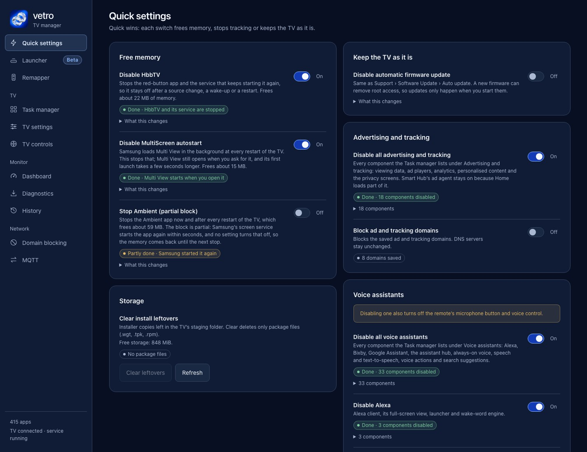

Each Vetro switch does one specific thing on the TV: it sets a disable flag on a group of components, writes a file that a Samsung service checks, stops or masks services, or changes one menu value. This page describes Vetro 0.7.0, which follows 0.5.0 (released on 2026-11-06). It lists what each switch does, how to undo it, and what the project says is not yet verified, using the [README](https://github.com/andrearicci93/vetro/blob/main/README.md), the [CHANGELOG](https://github.com/andrearicci93/vetro/blob/main/CHANGELOG.md) and the documents they link.

Vetro is experimental and needs root, and it ships no signed installer: [Vetro's root requirements](/root/how-to-root-samsung-tv/) and [the risks of rooting](/root/is-it-safe-to-root-samsung-tv/) come first, and [Apps2Samsung](/root/install-vetro-apps2samsung/) does the signing. Most effects were tried on one Samsung [Q80A](/tested-tvs/q80a/). Where the changelog says a part was not tried on a TV, the table says so.

## What do the Quick settings switches do?

Quick settings opens on General, followed by Privacy and ads, Voice, Disable, Uninstall and Developer settings. Every switch shows Done or Partly done. On a TV without root access the switches say Root required. The undo column uses only behavior the changelog, README or dashboard documents; where none is documented, it says so.

### General

| Switch | What it does on the TV | How to undo it | Status and caveats |
| --- | --- | --- | --- |
| Software update | Checks GitHub when you ask, verifies the signed bundle, replaces Vetro's files and restarts the launcher if needed | Goes back to the previous version by itself if the new one does not start within four minutes; you can also roll back by hand | Tried on a Q80A with the release key in 0.5.0, and updating from 0.5.0 to 0.7.0 was checked end to end. Changes to `config.xml` still need a reinstall. The Update Vetro tile on the TV does the same without a browser; [UPDATING.md](https://github.com/andrearicci93/vetro/blob/main/app/docs/UPDATING.md) says that path has not been tried on a TV yet |
| Clear leftovers (Storage) | Deletes install files left in the staging folder, one at a time, and refused while an installation runs. The extended cleanup also removes old network logs, temporary Prime Video pictures and caches of apps that are not running | Deleted files are not restored | The extended cleanup has not been checked on a TV. Settings, logins and other app data are not touched |
| Restore the TV and Remove Vetro | Shows the changes Vetro recorded and puts them back after one confirmation, with a result for each step. Deleting saved data and pairing is a separate confirmation | This is the undo | Uninstalled apps, settings without a saved previous value and changes made by plugins need manual recovery. The 0.5.0 notes say it was not tried on a TV |
| Turn off the factory test | Appears only when Samsung's factory colour test was left on. Turns it off | None documented | Tried only against a simulated TV |

### Essential settings (in General)

This section held the firmware switch in 0.5.0 and was renamed in 0.7.0.

| Switch | What it does on the TV | How to undo it | Status and caveats |
| --- | --- | --- | --- |
| Block firmware and software updates | Stops and masks every update service, not only the menu's Auto update: over-the-air firmware, Samsung's background app and package updates, app-binary downloads, system components and the preview updater. It turns the Auto update and app-binary switches off, removes download markers and applies the lock again after every restart: at power-on through the AT-HUB boot step where the TV has one (Tizen 6, 6.5 and 9), otherwise when Vetro's root agent starts | Switch off: the services are unmasked and the previous Auto update value comes back. Restore the TV includes it | Off by default and needs root. Read from the Tizen 6, 6.5 and 9 firmware; tried on a Q80A (firmware 2310.0) after a cold reboot; other models are not tried. While it is on, Samsung's firmware and app updates do not install. USB recovery is left working. A firmware update that lands anyway replaces everything it does ([#223](https://github.com/andrearicci93/vetro/issues/223)) |
| Quick boot (Experimental) | Creates the four boot-completion markers the TV waits for at about 10 seconds, through the same AT-HUB boot step, so Vetro and the launcher start earlier after power-on | Switch off, or Restore the TV: the vendor boot step comes back | On a Q80A, Vetro started at 28 to 31 s instead of about 97 s, and the launcher at 42 to 45 s instead of about 103 s. Tested on a Q80A only; Tizen 6.5 and 9 untested, and a TV without the AT-HUB step cannot use it |
| Hide remote key guides | Marks Samsung's remote key guides (the picture of the remote with "Press Volume: Mute" and similar) as seen, now and after each boot. 2024 and later TVs show them again after every power-on | Switch off: Samsung shows them again | Read from the Tizen 9 firmware; not yet tried on such a TV |
| Allow SDB from the local network | Lets developer tools on your network reach the TV's Samsung Debug Bridge, which installs apps and runs shell commands without Vetro pairing. The dashboard says turning it on improves compatibility with Apps2Samsung and TV-Store | Switch off, which disconnects them. Restore the TV turns it off | Moved here from Developer settings in 0.7.0. Off by default, asks for confirmation and stays on after restarts until you switch it off. See [the security model](/reference/vetro-security-model/) |

Why the firmware switch matters, and what it cannot promise, is covered in [will a firmware update remove root](/updates/firmware-update-remove-root/) and [stopping Samsung TV auto updates](/updates/stop-samsung-tv-auto-update/). In short: turn it on while root still works. It can help keep root; it does not guarantee it.

### Privacy and ads

| Switch | What it does on the TV | How to undo it | Status and caveats |
| --- | --- | --- | --- |
| Disable advertising and tracking services | Disables every component Apps and processes files under Advertising and tracking, including the viewing-recognition (ACR) services, and stops those that run | Switch off: the components are enabled again and their start-at-boot and auto-restart settings are restored. A failed change is rolled back | Components with the role Keep (Smart Hub's ad agent, which Home loads) and Vetro itself are left alone. The list differs by model |
| Enable DNS blocking | A filter on the TV writes full hostnames to the TV's hosts file and keeps your DNS servers | Switch off (the README says every switch can be turned back on) | Exact names only; it cannot guarantee that every app's ads or telemetry are blocked. See the domain filter note below |
| Stop viewing-data collection | Stops the services that recognise what is on screen, log remote key presses and send usage logs, now and after every restart | Switch off. An undo you make during startup is respected: pending retries no longer apply the change again. No other undo detail is documented | Effects on recognition and suggestions have not been verified |

### Voice

| Switch | What it does on the TV | How to undo it | Status and caveats |
| --- | --- | --- | --- |
| Disable all voice assistants, or Alexa, Google Assistant, Bixby and the other voice services one by one | Disables the voice components. The all-in switch takes its members from what Apps and processes lists under Voice assistants on your TV | Switch off | Also turns off the remote's microphone button, Voice Guide (read-aloud) and voice suggestions in search. Vetro asks you to confirm |

### Disable

| Switch | What it does on the TV | How to undo it | Status and caveats |
| --- | --- | --- | --- |
| Disable HbbTV | Sets the menu value, creates Samsung's own brake file, stops the HbbTV restart service where the TV has one, then stops the app, again after every restart | Switch on again: it removes the two flag files and starts the service and the app | In 0.3.0 the Q80A showed about 22 MB freed (one process survey). Standby, wake, cold boot and the red-button deeplink were not checked |
| Disable Multi View autostart | Creates a file that Samsung's start-up unit checks, and stops the app | Switch off | About 15 MB on the Q80A (0.3.0 survey). Multi View still starts on demand |
| Stop Ambient | Stops Ambient now and after each restart. Samsung's screen daemon can start it again, so the dashboard calls it a partial block | Switch off. You can also open Ambient yourself at any time | About 59 MB on the Q80A (0.3.0 survey). The effect on a running TV was only timed with the stop commands |
| Disable AirPlay | Stops the AirPlay receiver now and after restarts, so casting from Apple devices does not work while it is on | Included in Restore the TV | Appears only on TVs whose AirPlay setup supports it. Tried on a Q80A |
| Samsung TV Plus | New in 0.7.0. One switch for the app, its helpers and the two background services behind it, which systemd would otherwise start again | Switch off | The dashboard says it frees about 25 MB. No TV test is recorded in the changelog. See [removing Samsung TV Plus](/speed/disable-samsung-tv-plus/) |
| Vision AI | New in 0.7.0, shown only on 2024 and later TVs that have these apps. Holding Home, or the AI button of newer remotes, opens Samsung's AI screens (Click to Search, the AI companion), and turning off Bixby does not stop it. The switch turns those apps off, so nothing opens | Switch off | A short Home press works as before, and the Vision AI row of Samsung's Home stays. No TV test is recorded in the changelog |
| Apps you don't use | New in 0.7.0. One switch each for Netflix, Prime Video, YouTube, Apple TV, Disney+, Spotify, Xbox, GeForce NOW, Amazon Luna, Samsung Health, the Internet browser and Gallery, with their background services. A disabled app cannot start from its tile or its button on the remote | The same switch, or Restore the TV | Each TV only lists the apps it has |

### Uninstall

New in 0.7.0.

| Switch | What it does on the TV | How to undo it | Status and caveats |
| --- | --- | --- | --- |
| Uninstall apps that came with the TV | Deletes apps from a short, named list of apps that came with the TV (the Disable tab's app list without YouTube), the Samsung TV Plus app and the e-Manual (21 to 124 MB), and frees their space. Vetro also removes the Home line, registry row and icon that a plain uninstall leaves behind | Install the app again from Samsung's Apps, where it is offered. Vetro cannot bring it back | Each TV only lists the apps it has and allows removing. The Samsung TV Plus services stay; the Disable tab's switch stops them |
| Keep removed apps removed | On by default. Keeps apps you remove with Vetro off the TV and checks every 10 minutes for ones that came back. It was in General before 0.7.0 | Select Allow again before reinstalling an app yourself. Turning the switch off stops the checks but keeps the list | Tried on a Q80A |

The memory figures come from a process survey of one TV, not from a speed test. The project's [performance record](https://github.com/andrearicci93/vetro/blob/main/app/docs/PERFORMANCE.md) measured memory only, not frame rate or input latency; see [what uses memory on a Samsung TV](/speed/samsung-tv-memory-usage/).

### Developer settings

| Switch | What it does on the TV | How to undo it | Status and caveats |
| --- | --- | --- | --- |
| Require pairing | Chooses automatic (default), always on or always off for the dashboard and API sign-in | Choose another mode. Turning it off asks for confirmation. Restore the TV does not change it | See [the security model](/reference/vetro-security-model/) |
| Update notices | New in 0.7.0. This browser checks GitHub for new Vetro and Shard versions when the page opens and every six hours, and marks the menu | Switch off | Off by default. Nothing is downloaded or installed: you still press Update |
| Diagnostic report | Downloads a redacted JSON report to your computer. Reading changes no flags, processes, settings or services | Nothing to undo | Optional setting Include unrecognised components is off by default. Attach the report to a [GitHub issue](https://github.com/andrearicci93/vetro/issues/new?template=log_report.yml) when something does not work |

## How does the domain filter choose its names?

The filter matches exact hostnames: blocking `samsungads.com` does not block `rtb-config.samsungads.com`. The candidate names come in three groups, described in [DOMAIN-FILTER.md](https://github.com/andrearicci93/vetro/blob/main/app/docs/DOMAIN-FILTER.md).

- Firmware-derived names are strings found in the Q80A firmware image, each tied to the component that references it. Whether a name is reached at run time, and what happens when it is blocked, was not tested on a TV.
- Reported names come from public reports. None of them is in the firmware.
- One probable name, `gpm.samsungqbe.com`, is a guess at where the viewing-data service learns its servers. It is not in the firmware and not confirmed in traffic, so the dashboard labels it unverified.

The filter refuses the names the TV uses for its internet check, its clock and Samsung's Certificate Manager. The software-update servers are not on that list, but blocking them stops firmware updates, so the project points to its Quick settings switch, now Block firmware and software updates, as the easier one to undo. The usage-log domain that Stop viewing-data collection adds to your saved list does not turn the filter on: DNS blocking stays your choice, and the data service can still run until it is on.

## What do the Vetro UI options change?

Everything Vetro draws on the TV is switched on the dashboard's Vetro UI page, which the side menu marks Preview: the launcher, live TV (Vetro TV Tuner), the volume bar and the number pad. Its Overview tab has one switch per part, and the [Vetro UI guide](https://github.com/andrearicci93/vetro/blob/main/app/docs/VETRO-UI.md) says some parts may not work on every TV yet. The page, the switch-over between launchers and the automatic remote interception are tested on the computer only. Report problems in a [GitHub issue](https://github.com/andrearicci93/vetro/issues/new?template=log_report.yml) with the diagnostic report from Quick settings → Developer settings → Diagnostic report.

The launcher is off until you turn it on, after an in-page warning. Turning it on closes Samsung's Home and switches off the Autorun Smart Hub setting so the TV no longer powers on to Samsung's Home. Vetro remembers the old value and puts it back only if it changed it. Nothing is removed: if the launcher stops, the Home key goes back to Samsung's Home. Only one launcher answers the Home key at a time: Samsung's Home, the Vetro launcher or another app. [Why the launcher is native](/reference/why-vetro-is-native/) explains the design.

| Option | Where | What it does | How to undo it | Status and caveats |
| --- | --- | --- | --- | --- |
| Your own row | On the TV | Hold OK on a tile to move it (Left, Right) or take it out (Down); in All apps, hold OK to add an app. The row starts as Samsung's Home row, and Samsung's own row is never written | Use Samsung's row again, on the Launcher tab | Holding OK on a physical remote is listed in the Vetro UI guide as not yet tried on a TV |
| Control center cards | Launcher tab, Control center | Down on the apps row opens up to three cards: Task manager (running apps by memory), Audio output, Picture mode and Sleep timer | Each card has its own switch and is off until you turn it on | The Vetro UI guide lists two or three cards and the Audio output card as still to be tried on a TV |
| Reduce motion | Launcher tab, Vetro launcher | Turns off all launcher animations | Switch off | |
| Fix TizenTube | Launcher tab, Vetro launcher | Gives the TizenTube tile the YouTube icon and closes Samsung's YouTube just before TizenTube starts | Switch off | Greyed out when TizenTube is not in the app list. See [TizenTube on a Samsung TV](/control/tizentube-samsung-tv/) |
| HDMI sources on Home | Launcher tab, Vetro launcher | Shows the HDMI tiles already in Samsung's Home row, in the same positions | Switch off (off by default) | Tested by a contributor on an S95C |
| HDMI source images | Launcher tab, Vetro launcher | Uses Samsung's artwork instead of generic icons | Switch off (off by default) | |
| TV-Store in All apps | Launcher tab, Vetro launcher | When TV-Store is installed, the store pill at the end of All apps opens it, with Samsung's store as the fallback | Switch off to use Samsung's store | |
| Custom launcher | Launcher tab, Custom launcher | Pick any installed app and the Home key opens it. Samsung's Home stays enabled and Vetro closes it after each Home press | Switch off undoes all of it. If the app keeps failing to start, the mode turns itself off | The 0.5.0 notes said it was not tried by hand on a TV; owner reports on a [QN90B](/tested-tvs/qn90b/) and a [CU8070](/tested-tvs/cu8070/) say the Home key opened a custom launcher. It does not cover an app on the home screen at power-on ([#127](https://github.com/andrearicci93/vetro/issues/127)) |
| Samsung Home switch | Launcher tab | Disables Samsung's Home; asks for confirmation | Switch Samsung Home back on | Keep Samsung's Home enabled: on the Q80A, disabling it can keep the TV from finishing its boot (see [RELEASE-0.5.0.md](https://github.com/andrearicci93/vetro/blob/main/app/docs/RELEASE-0.5.0.md)) |
| Live TV | Live TV tab | One switch for Vetro's own tuner: Banner, Channel list, Channel pad, Info, TV guide and Audio toast drawn over the picture on the TV input. Samsung's tuner is never removed or changed | Switch off: Samsung's tuner is back as it was | The [tuner guide](https://github.com/andrearicci93/vetro/blob/main/app/docs/TUNER.md) says it was developed and run on one Q80A with an antenna, that its wiring into Vetro is tested on the computer and not yet on a TV, and that cable and satellite are not covered |
| Volume bar | On-screen displays tab | Vol and Mute show Vetro's bar instead of Samsung's, on an edge you choose, or nothing at all (Hidden) | Switch off | Needs the remote interception, which Vetro UI turns on by itself, and the Vetro launcher or another app on the Home key. On optical, HDMI receivers and Bluetooth, Vol goes to Samsung and Samsung's bar shows; the optical and Bluetooth changes are not yet tried on a TV |
| Number pad | On-screen displays tab | 123 opens Vetro's number pad; Done tunes Vetro's live TV | Switch off | Same needs as the volume bar |

While the volume bar or the number pad is on, their keys (Vol, Mute and 123) are listed first in the Remapper, locked, and a shortcut of yours on the same key is marked Overridden by Vetro UI. Both pages ask before taking a key from the other.

## What do the Apps and processes actions do?

Apps and processes, the dashboard page called Task manager before 0.7.0, lists every app and service on the TV with a plain description and a role: Tracking, Optional or Keep. In 0.7.0 the name Task manager belongs to the Control center card on the TV. The Not used at home role was removed in 0.5.0. Hotel, shop and factory apps open only after a warning.

| Action | Effect | Undo |
| --- | --- | --- |
| Disable | Sets a disable flag. The component stays installed | Enable it again |
| Stop | Ends the running process | It may start again by itself; a stopped service returns after a restart unless something holds it off |
| Uninstall | Removes the package | Needs an installer to recover. Keep removed apps removed will keep it off until you select Allow again |

Protected system components cannot be touched, and uninstalling a package also protects its siblings. Quick settings and Apps and processes share one inventory, so an assistant disabled in one shows as disabled in the other.

## What do the other tabs change?

The Remapper turns a remote key into an app launch, or, since 0.7.0, into another key: an input (TV, HDMI 1 to 4), play and pause keys, Home, Back, OK, the arrows or volume (Send key in Step 2). Shortcuts survive restarts, and a key can also send an MQTT message ([remapping Samsung remote buttons](/control/remap-samsung-remote-buttons/)). Settings and controls writes supported picture and advanced settings with read-back, and restore of saved values. The Home Assistant tab publishes the TV's state and accepts actions on exact topics ([Home Assistant and Samsung TV](/control/home-assistant-samsung-tv/)). Vetro Shards (plugins) are third-party code with the same access as Vetro, off until you switch them on.

## Is every switch reversible?

Turning a switch back is the documented undo, but it only works while Vetro and its root helper stay reachable, and it is not a promise to recover from every failure, such as lost network access or a TV that stalls its boot. Restore the TV puts back what Vetro recorded and lists what needs manual recovery. A firmware update that installs anyway replaces the system software, and with it every change Vetro made, root included. Since 0.5.0 the dashboard asks for a six-digit code shown on the TV once the Vetro app has been seen; see [the security model](/reference/vetro-security-model/), and the [uninstall guide](/root/uninstall-vetro-samsung-tv/) for removal.

Next steps: [remove ads from the home screen](/speed/remove-ads-samsung-tv-home-screen/), [turn off ACR](/privacy/turn-off-acr-samsung-tv/), or check your model in the [tested TVs index](/tested-tvs/).
