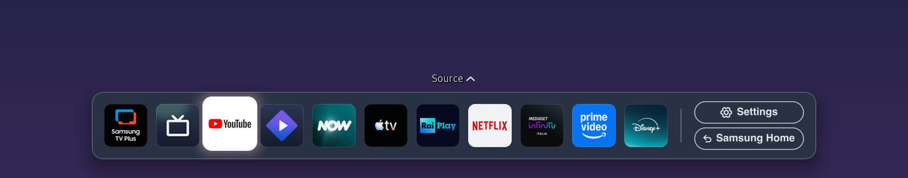

Vetro's launcher is a native program, not a web page in a browser engine. It is written in C#, draws with the TV's own EFL graphics libraries and runs under the TV's own `dotnet`, as the [dock README](https://github.com/andrearicci93/vetro/blob/main/dock/README.md) describes. The reason is memory. On a Samsung [Q80A](/tested-tvs/q80a/), Samsung's Home process held about 152 MB resident, the launcher about 22 MB, and available RAM went from 533 MB to 662 MB when the launcher replaced it. That is one run, and it measures memory only.

Vetro is experimental, needs root and ships no signed installer: see [Vetro's root requirements](/root/how-to-root-samsung-tv/) and [the risks of rooting](/root/is-it-safe-to-root-samsung-tv/). The launcher is a beta feature, and the dashboard you use to turn it on is web, not native.

## What is native and what is web in Vetro?

Three parts, built differently on purpose.

| Part | Built as | What it does |
| --- | --- | --- |
| Launcher (the bar on the Home key) | Native: C# in `dock/`, run by the TV's `dotnet` | Draws the apps, reads the remote, opens apps |
| Dashboard (Quick settings, Task manager, Remapper) | Web page served by Vetro's service | Lets you configure everything from a computer or phone |
| Small page on the TV | Web, closes itself | Reports the TV's model and firmware, and shows pairing codes and refusals |

The dashboard is not meant to be fast on the TV. You open it in a browser on another device, so its cost falls on that device. The launcher has to run on the TV all the time, so it is where memory matters. Since 0.5.0 the launcher is also the first bundled plugin: it updates and rolls back together with Vetro, and it cannot be removed or replaced from the plugin catalog ([plugin architecture](https://github.com/andrearicci93/vetro/blob/main/app/docs/PLUGIN-ARCHITECTURE.md)).

## How much memory does the native launcher use?

From the project's [performance record](https://github.com/andrearicci93/vetro/blob/main/app/docs/PERFORMANCE.md), on a Samsung QE50Q80AATXZT with firmware T-NKM2DEUC-2301.1:

| Measurement | Samsung Home running | Launcher on, Samsung Home closed |
| --- | ---: | ---: |
| Available RAM | 533 MB | 662 MB |
| Samsung Home (`com.samsung.tv.csfs`), resident memory | about 152 MB (PSS about 100 MB) | closed |
| Launcher process, resident memory | none | about 22 MB (about 30 MB in a later read, PSS 5.7 MB) |

Available RAM rose by about 129 MB, or 24%. The record is explicit that this was a single run taken by hand during development, not an A/B test, not repeated, and dependent on what else was running. Nothing there shows a change in frame rate, input latency or the time to open an app. The claim is only that the launcher leaves more memory free, and the README says other TVs will differ.

There is no measurement of a web launcher in the project's files, so this page makes no comparison with one. The only measurement of web content on the TV is the small Vetro page that reports the model. The [0.3.0 changelog](https://github.com/andrearicci93/vetro/blob/main/CHANGELOG.md) says its web app and web process held about 100 MiB resident (RSS, which includes shared pages) in a benchmark sample on the Q80A, and that the page now closes itself 5 seconds after the report reaches the service. See the [comparison of Vetro, AeroTizen, free-my-tv and TizenBrew](/compare/vetro-vs-aerotizen-free-my-tv-tizenbrew/) for the other tools.

## How does it start on the Home key?

Vetro runs the launcher process and starts it again after a restart or a crash, backing off for up to five minutes between tries (0.3.0). If the launcher stops, the Home key goes back to Samsung's Home, and nothing is disabled or removed. Turning it on also switches off the Autorun Smart Hub setting, which Vetro restores if it was the one that changed it.

The awkward part is that the system also sends Home to Samsung's own Home app. The launcher therefore closes that app again. According to [STATE-MACHINES.md](https://github.com/andrearicci93/vetro/blob/main/app/docs/STATE-MACHINES.md), a Home press arms one guard process that kills Samsung Home at 0.15, 0.3, 0.45, 0.7 and 1.2 seconds, and every kill first checks a generation counter. If you choose Samsung Home from the bar, the guard is cancelled so the remaining kills do nothing. A Home press seen by both the display server and the input device within 1.5 seconds is counted once.

That guard is how the memory is held. Since 0.5.0 the guard also handles Samsung's Home panels that overlap the launcher, adapted from community pull requests [#23](https://github.com/andrearicci93/vetro/pull/23) and [#24](https://github.com/andrearicci93/vetro/pull/24).

## What does native cost?

The first cost is fewer visual options. The dock README lists what could not be ported from the design page: the blurred background behind the bar, label fonts, the brightness boost on a selected pill and desaturation of unselected icons. The shipped look has no name labels and no clock.

The second is a tighter tie to the firmware. The launcher calls the TV's [EFL](https://www.enlightenment.org/about-efl) libraries directly and is built for the .NET Core 3.1 runtime on the TV. The 0.3.2 changelog notes that on Tizen 9 TVs the launcher then closed only `com.samsung.tv.csfs`, so the memory freed may be smaller than on the Q80A; 0.5.0 added the multi-app guard above, and no memory figure for a Tizen 9 TV is documented.

The third is narrow testing. The README reports the launcher working on 2022 sets only from 0.3.1 onward (the Home cache folder fix), the HDMI options were tested on an S95C by their author, and on The Frame ([LS03B](/tested-tvs/ls03b/)) the launcher was not tried. Compatibility is listed per model in the README and the [tested TVs index](/tested-tvs/).

The fourth is that a guard racing a slow app is a workaround, not an official Samsung switch. If you want any app on the Home key instead, Vetro's Custom launcher does that without drawing a bar; see [what each Vetro switch changes](/reference/what-each-vetro-switch-changes/) for its caveats, and [a custom launcher for a Samsung TV](/speed/custom-launcher-samsung-tv/) for the general idea. For removing Samsung's ads from Home, see [removing ads from the home screen](/speed/remove-ads-samsung-tv-home-screen/), and for memory in general, [what uses memory on a Samsung TV](/speed/samsung-tv-memory-usage/).

## Limits

This is a design note, not a benchmark. The documented numbers cover memory on one TV. Launcher start time, input latency and frame rate have not been measured, and the performance record says so. The dashboard now asks for a pairing code but still runs over plain HTTP, which the [security model](/reference/vetro-security-model/) covers. The upstream root that Vetro builds on is [Chris Ritsen's samsung-tv-root research](https://github.com/chris-ritsen/samsung-tv-root).
