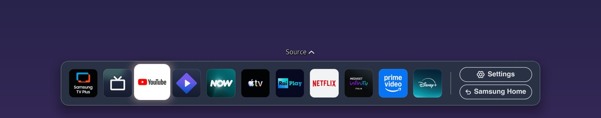
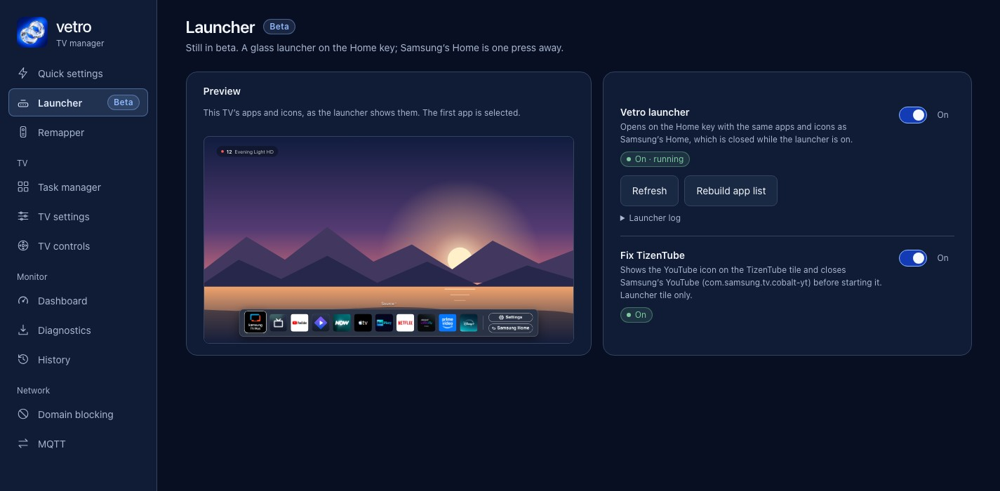

A custom launcher on a Samsung TV is an app that opens when you press the Home key, instead of Samsung's own Home screen. Home replacement depends on the tool: Vetro requires root; AeroTizen documents both a no-root Native Home mode and a watcher that reopens its launcher. Vetro's launcher is a native bar that runs on a rooted TV. In Vetro 0.7.0 it is part of Vetro UI, which the dashboard marks Preview, and this page covers what it does, the one memory figure we can cite and where its documentation stops.

## What is a launcher on Tizen?

It is an app that shows a list of other apps. The hard part is not drawing it. It is being what opens on the Home key, and staying out of the way of the TV's own start-up. On the Q80A ([model page](/tested-tvs/q80a/)), the [CHANGELOG](https://github.com/andrearicci93/vetro/blob/main/CHANGELOG.md) names Samsung's Home as the system app `com.samsung.tv.csfs`. TVs from 2022 onward ship a newer Home (`com.samsung.tv.home.media`, `home.sidebar`, `coba.newhome`) that keeps its data in a different folder, and a launcher has to handle both. For those TVs, 0.7.0 changes how the launcher opens Samsung's Home and opens the Vetro launcher once at power-on; the changelog says both were read from the 2022 and 2024 firmware and not yet tried on those TVs.

## How does Vetro's launcher replace Samsung's Home?

According to the [README](https://github.com/andrearicci93/vetro/blob/main/README.md), it is a minimal bar on the Home key that starts with the same apps and icons as Samsung's Home, in the same order, and comes back by itself after a restart or a standby. A Samsung Home button opens the original, and nothing is removed.

As far as the changelog documents:

- It is a native program, not a web page: a .NET process run by the TV's own `dotnet`.
- It reads its app list from Samsung's Home row (row order, registry titles and registry icons) each time it starts. On TVs with the newer Home it uses the cache folder where that Home keeps its order, and where the Home row holds only recent apps it adds the other visible installed apps.
- It listens for the Home key. Up to 0.5.0, Samsung's Home started on every press and Vetro closed it a moment later, with a guard that repeats after each press ([PERFORMANCE.md](https://github.com/andrearicci93/vetro/blob/main/app/docs/PERFORMANCE.md)). In 0.7.0 the launcher claims the Home key from the TV after the first press it reads from the remote, so from the second press on only the launcher answers. The changelog says this was tried on a Q80A (Tizen 6.0); the call exists in the 2022 and 2024 firmware but was not yet tried there, and it does not apply in custom launcher mode.
- If the launcher stops, the Home key goes back to Samsung's Home, and Vetro starts the launcher again after a restart or a crash, backing off between tries.
- Turning the launcher on also switches off Samsung's Autorun Smart Hub setting so the TV no longer powers on to Samsung's Home. Vetro remembers the old value and puts it back only if it changed it.

You turn it on in the dashboard's Vetro UI page, on the Launcher tab (sub-tab Vetro launcher), which also previews the bar. The [Vetro UI guide](https://github.com/andrearicci93/vetro/blob/main/app/docs/VETRO-UI.md) says the page is experimental and that some parts may not work on every TV yet.

## Can I change which apps the launcher shows?

Yes, from 0.7.0. The row starts as Samsung's Home row, and you change it on the TV: hold OK on a tile to move it with Left and Right, or press Down to take it out. Vetro keeps your order on top of Samsung's row, new apps arrive at the end, and Samsung's own Home row is never written. The **All apps** pill at the end of the row lists every app Samsung's Apps screen lists, plus Samsung TV Plus and Live TV; hold OK there to add an app to the row or take it out. On the Sources page (Up), holding OK on the TV input or an HDMI input adds it to the row. **Use Samsung's row again** on the Launcher tab forgets your row. An app installed from Samsung's store, TV-Store or Apps2Samsung shows up the next time the launcher opens, without a restart.

## What is the Control center?

Down on the apps row opens the Control center: up to three cards side by side. The [CHANGELOG](https://github.com/andrearicci93/vetro/blob/main/CHANGELOG.md) lists a Task manager (running apps by memory; OK switches to one, holding OK closes it), Audio output (the TV speakers or a paired Bluetooth device), Picture mode and Sleep timer, the last two being Samsung's own settings. Each card has its own switch on the Launcher tab and is off until you turn it on. The Vetro UI guide lists the Control center with two or three cards, the Audio output card and holding OK on a physical remote among what is still to be tried on a TV.

If something in the launcher or the Control center misbehaves, open a [GitHub issue](https://github.com/andrearicci93/vetro/issues/new?template=log_report.yml) with the diagnostic report from Quick settings → Developer settings → Diagnostic report.

## How much memory does the launcher save?

In a single hand-taken run on a Q80A (firmware 2301.1), available RAM went from 533 MB with Samsung's Home running to 662 MB with the launcher on, about 129 MB or 24%. Samsung's Home used about 152 MB resident and the launcher about 22 MB (about 30 MB in a later read). The performance notes say the run was not an A/B test and was not repeated, and that it measures memory only: nothing in it shows a change in frame rate, input latency or time to open an app. See [what uses memory on a Samsung TV](/speed/samsung-tv-memory-usage/). Vetro has no comparison with other launchers.

## What is the Custom launcher tab?

Added in 0.5.0 and now a sub-tab of Vetro UI's Launcher tab: pick an installed app, turn the switch on, and the Home key opens that app. Samsung's Home stays enabled, Vetro closes it after each Home press, and Autorun Smart Hub is switched off. Turning the switch off undoes this, and if the app keeps failing to start, the mode turns itself off and the Home key goes back to Samsung. The 0.5.0 changelog said this mode had not been tried by hand on a TV. Since then two owner reports in the README say the physical Home key opened a custom launcher, on a [QN90B](/tested-tvs/qn90b/) ([#158](https://github.com/andrearicci93/vetro/issues/158)) and a [CU8070](/tested-tvs/cu8070/) ([#183](https://github.com/andrearicci93/vetro/issues/183)).

## Why doesn't Vetro disable Samsung's Home?

The changelog says to keep Samsung's Home enabled: on the Q80A, disabling it can keep the TV from finishing its boot. Samsung's Home is closed after the Home key is pressed instead. The changelog describes this for one TV and one firmware, and the Home-state changes in Quick settings and Apps and processes (the dashboard page once called Task manager) are blocked while the Vetro launcher is on ([HARDENING-0.5.0.md](https://github.com/andrearicci93/vetro/blob/main/app/docs/HARDENING-0.5.0.md)). In 0.7.0, Vetro also closes Samsung's Home after a boot once the launcher runs and the TV has been up five minutes.

## How does it compare with AeroTizen?

AeroTizen is another launcher for Samsung TVs. Its [README](https://github.com/helalaou/AeroTizen/blob/main/README.md) says Developer Mode is sufficient for setup, a computer-based CLI installs it, and both of its Home modes work without root. Native Home sends Home presses directly to AeroTizen and is marked experimental, and the watcher reopens AeroTizen when it detects a return to Samsung's Home. The README states that Native Home is reported not to work on Tizen 10. AeroTizen's watcher reacts after Samsung Home appears; its experimental Native Home mode routes Home directly to AeroTizen. Both work without root, while Vetro requires root and closes Samsung Home. [Vetro versus AeroTizen, free-my-tv and TizenBrew](/compare/vetro-vs-aerotizen-free-my-tv-tizenbrew/) compares them and [why Vetro is native](/reference/why-vetro-is-native/) covers the design choice.

## What should I know before trying it?

- Vetro is experimental, needs root and ships no signed installer: you sign the package with your own Samsung certificate or use a tool such as Apps2Samsung. Read [whether rooting a Samsung TV is safe](/root/is-it-safe-to-root-samsung-tv/) and [how to install Vetro with Apps2Samsung](/root/install-vetro-apps2samsung/). The root comes from Chris Ritsen's [samsung-tv-root research](https://github.com/chris-ritsen/samsung-tv-root); [Vetro's root requirements](/root/how-to-root-samsung-tv/) explain the route.
- The Q80A is the TV Vetro is developed on. The README table lists other models as reported working, some with fixes, and one 2022 TV's launcher failed until the 0.3.1 fix. Root features target Tizen 6 to 9; Tizen 10 has no root yet ([#181](https://github.com/andrearicci93/vetro/issues/181)). See [tested TVs](/tested-tvs/).
- Vetro UI, which holds the launcher, is marked Preview in the dashboard. Many of its 0.7.0 changes are marked in the changelog as not yet tried on a TV.

## Next steps

Go on to [removing ads from the Samsung home screen](/speed/remove-ads-samsung-tv-home-screen/), or [remapping remote buttons](/control/remap-samsung-remote-buttons/).
