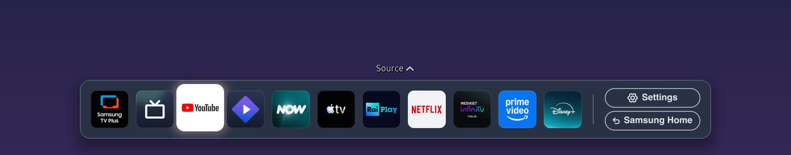
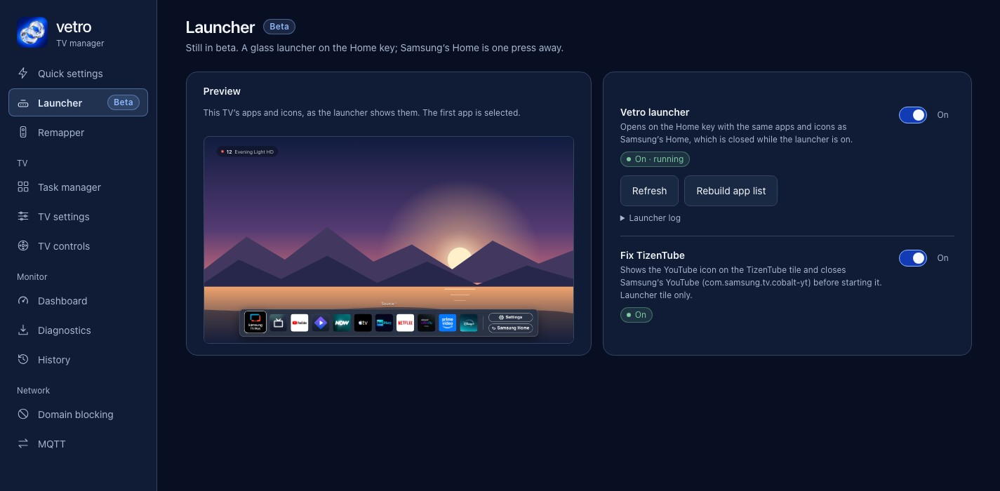

A custom launcher on a Samsung TV is an app that opens when you press the Home key, instead of Samsung's own Home screen. Replacing Home needs either a rooted TV or a tool that watches for Samsung's Home and reopens your app. Vetro's launcher is a native bar that runs on a rooted TV. It is in beta, and this page covers what it does, the one memory figure we can cite and where its documentation stops.

## What is a launcher on Tizen?

It is an app that shows a list of other apps. The hard part is not drawing it. It is being what opens on the Home key, and staying out of the way of the TV's own start-up. On the Q80A ([model page](/tested-tvs/q80a/)), the [CHANGELOG](https://github.com/andrearicci93/vetro/blob/main/CHANGELOG.md) names Samsung's Home as the system app `com.samsung.tv.csfs`. TVs from 2022 onward ship a newer Home (`com.samsung.tv.home.media`, `home.sidebar`, `coba.newhome`) that keeps its data in a different folder, and a launcher has to handle both.

## How does Vetro's launcher replace Samsung's Home?

According to the [README](https://github.com/andrearicci93/vetro/blob/main/README.md), it is a minimal bar on the Home key that shows the same apps and icons as Samsung's Home, in the same order, and comes back by itself after a restart or a standby. A Samsung Home button opens the original, and nothing is removed.

As far as the changelog documents:

- It is a native program, not a web page: a .NET process run by the TV's own `dotnet`.
- It reads its app list from Samsung's Home row (row order, registry titles and registry icons) each time it starts. On TVs with the newer Home it uses the cache folder where that Home keeps its order, and where the Home row holds only recent apps it adds the other visible installed apps.
- It listens for the Home key. When you press it, the launcher opens and Samsung's Home is closed, with a guard that repeats after each press ([PERFORMANCE.md](https://github.com/andrearicci93/vetro/blob/main/app/docs/PERFORMANCE.md)).
- If the launcher stops, the Home key goes back to Samsung's Home, and Vetro starts the launcher again after a restart or a crash, backing off between tries.
- Turning the launcher on also switches off Samsung's Autorun Smart Hub setting so the TV no longer powers on to Samsung's Home. Vetro remembers the old value and puts it back only if it changed it.

You turn it on in the Launcher page of the Vetro dashboard, which also previews the bar. The changelog says it was tested on a Q80A only and is experimental on other models.

## How much memory does the launcher save?

In a single hand-taken run on a Q80A (firmware 2301.1), available RAM went from 533 MB with Samsung's Home running to 662 MB with the launcher on, about 129 MB or 24%. Samsung's Home used about 152 MB resident and the launcher about 22 MB (about 30 MB in a later read). The performance notes say the run was not an A/B test and was not repeated, and that it measures memory only: nothing in it shows a change in frame rate, input latency or time to open an app. See [what uses memory on a Samsung TV](/speed/samsung-tv-memory-usage/). Vetro has no comparison with other launchers.

## What is the Custom launcher tab?

The 0.5.0 changelog adds a Custom launcher tab: pick an installed app, turn the switch on, and the Home key opens that app. Samsung's Home stays enabled, Vetro closes it after each Home press, and Autorun Smart Hub is switched off. Turning the switch off undoes this, and if the app keeps failing to start, the mode turns itself off and the Home key goes back to Samsung. The changelog states this mode has not been tried by hand on a TV, so treat it as untested.

## Why doesn't Vetro disable Samsung's Home?

The changelog says to keep Samsung's Home enabled: on the Q80A, disabling it can keep the TV from finishing its boot. Samsung's Home is closed after the Home key is pressed instead. The changelog describes this for one TV and one firmware, and the Home-state changes in Quick settings and the Task manager are blocked while the Vetro launcher is on ([HARDENING-0.5.0.md](https://github.com/andrearicci93/vetro/blob/main/app/docs/HARDENING-0.5.0.md)).

## How does it compare with AeroTizen?

AeroTizen is another launcher for Samsung TVs. Its [README](https://github.com/helalaou/AeroTizen/blob/main/README.md) says Developer Mode is sufficient for setup, a computer-based CLI installs it, and both of its Home modes work without root. Native Home sends Home presses directly to AeroTizen and is marked experimental, and the watcher reopens AeroTizen when it detects a return to Samsung's Home. The README states that Native Home is reported not to work on Tizen 10. That is a different trade-off: no root, but Samsung's Home still starts and a watcher reacts to it, while Vetro closes Samsung's Home but needs root. [Vetro versus AeroTizen, free-my-tv and TizenBrew](/compare/vetro-vs-aerotizen-free-my-tv-tizenbrew/) compares them and [why Vetro is native](/reference/why-vetro-is-native/) covers the design choice.

## What should I know before trying it?

- Vetro is experimental, needs root and ships no signed installer: you sign the package with your own Samsung certificate or use a tool such as Apps2Samsung. Read [whether rooting a Samsung TV is safe](/root/is-it-safe-to-root-samsung-tv/) and [how to install Vetro with Apps2Samsung](/root/install-vetro-apps2samsung/). The root comes from Chris Ritsen's [samsung-tv-root research](https://github.com/chris-ritsen/samsung-tv-root); [Vetro's root requirements](/root/how-to-root-samsung-tv/) explain the route.
- The Q80A is the TV Vetro is developed on. The README table lists other models as reported working, some with fixes, and one 2022 TV's launcher failed until the 0.3.1 fix. See [tested TVs](/tested-tvs/).
- The launcher is in beta.

## Next steps

Go on to [removing ads from the Samsung home screen](/speed/remove-ads-samsung-tv-home-screen/), or [remapping remote buttons](/control/remap-samsung-remote-buttons/).
