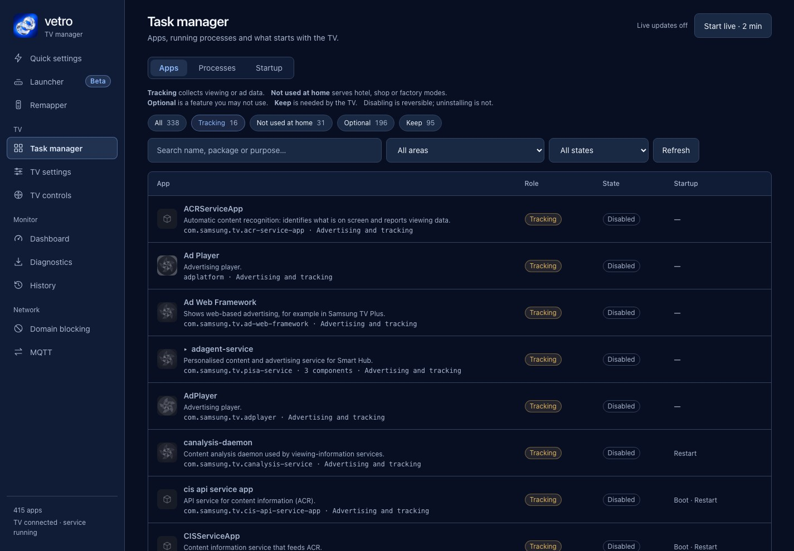

Samsung TV Plus can be hidden but not removed. Samsung's Canadian support page says it "is an integrated feature of your TV and it can not be fully removed". You can delete its channels and take the app tile off the Home row, and Samsung says new channels are added from time to time, so you may have to delete them again. This page gives Samsung's steps first, then what a rooted TV adds and where Vetro's documentation stops.

## How do I remove Samsung TV Plus channels?

[Samsung's Canadian page](https://www.samsung.com/ca/support/tv-audio-video/tv-samsung-tv-plus/) gives two things you can do. Menu names differ by model, year and country.

1. Remove the channels. Press Home, go to TV Plus, hover over the app, select Channel List, then Edit Channels. Mark the channels you want gone and select Delete. Samsung's [US page](https://www.samsung.com/us/support/answer/ANS10000933/) says that if you remove all channels, the app will not play automatically until new channels are added.
2. Remove the app tile. Highlight it on the Home row, press Down on the remote, select Remove and confirm.

The Canadian page also says new channels are added periodically and you will need to remove them again if you don't want Samsung TV Plus. The US page adds that you can stop it launching automatically by turning off the Autorun option under Settings, General, Smart Features. Neither page describes a separate "Disable" option for the app.

To bring the channels back, Samsung points to Settings, Support, Self Diagnosis, Smart Hub Reset, and warns that it signs you out of all your apps.

## Why does Samsung TV Plus come back?

Because it is part of the TV's software, not an app you installed. Hiding it removes the tile and the channel list, not the integrated service behind it. Samsung's pages say channels are re-added over time; they don't say what triggers it.

## What changes on a rooted TV?

Root lets you see the components behind the feature and disable them one at a time. Vetro's Task manager lists every app and service on the TV with a plain description and a role, and can disable, stop or uninstall them behind an in-page confirmation. Disabling keeps the component installed and can be reversed, and protected system components can't be touched ([README](https://github.com/andrearicci93/vetro/blob/main/README.md)).

Vetro is experimental, needs root and ships no signed installer. Read [whether rooting a Samsung TV is safe](/root/is-it-safe-to-root-samsung-tv/) and [how to install Vetro with Apps2Samsung](/root/install-vetro-apps2samsung/) first, and see [Vetro's root requirements](/root/how-to-root-samsung-tv/) for the route.

What the Vetro repository documents about TV Plus:

- The [domain filter notes](https://github.com/andrearicci93/vetro/blob/main/app/docs/DOMAIN-FILTER.md) list four advertising hostnames, found in the Q80A firmware, that `tvplus` references along with other components: `rtb-config.samsungads.com`, `tvp-ads-log.samsungads.com`, `tvp-interactive-ad.samsungads.com` and `rtb-config-canary.samsungads.com`. The notes say that whether a name is reached at run time, and what happens when it is blocked, has not been tested on a TV.
- The [CHANGELOG](https://github.com/andrearicci93/vetro/blob/main/CHANGELOG.md) records the `rtb-config-canary` name as an untested domain candidate.

The repository documents no dedicated "disable TV Plus" switch, no effect of disabling the TV Plus package on a running TV, and no memory figure for it. If you try it in the Task manager, check afterwards that the TV still behaves, and expect to find out for yourself.

## Does DNS blocking get rid of Samsung TV Plus?

DNS blocking can refuse requests for selected hostnames, but the TV Plus candidates in Vetro's filter come from strings in the Q80A firmware and have not been verified in traffic or tested for blocking effects. It does not remove the app or its channels, and the ad hostnames it shares with other components make a broad list risky. [Blocking Samsung TV telemetry with DNS](/privacy/block-samsung-tv-telemetry-dns/) covers the trade-offs.

## Should I use the Task manager for this?

Only if you already run Vetro for other reasons. Each component shows a role: Tracking, Optional or Keep. You can search by name, package or purpose to find TV Plus and related components. Disable, stop and uninstall are three levels: disable keeps the component installed and can be reversed, stop ends the running process, and uninstall needs an installer to recover. Start with disable.

Components can depend on each other, and the domain notes show that the ad hostnames are shared between several of them. Disabling one thing can change another. Vetro's descriptions come from the Q80A's firmware ([model page](/tested-tvs/q80a/)), so on other models some packages are unclassified and left alone.

After any change, open the Home screen, change the source, wake the TV from standby and check that nothing you use broke. Vetro's switches can be turned back on if it did.

## Will it stay removed after a firmware update?

Samsung's pages say channels are added again over time, and Vetro's records contain no test of TV Plus across a firmware update. What the project says about updates is in [will a firmware update remove root](/updates/firmware-update-remove-root/). The 0.5.0 changelog adds a setting, Keep removed apps removed, that checks every 10 minutes for apps you removed with the Task manager that came back; it was tested on a Q80A, not on TV Plus.

## Limits

Samsung's pages are the Canadian and US ones; other countries may differ. Nothing here is warranty or legal advice.

## Next steps

See [removing ads from the Samsung TV home screen](/speed/remove-ads-samsung-tv-home-screen/), [the Samsung ads opt-out guide](/privacy/samsung-ads-opt-out/) and [what uses memory on a Samsung TV](/speed/samsung-tv-memory-usage/).
