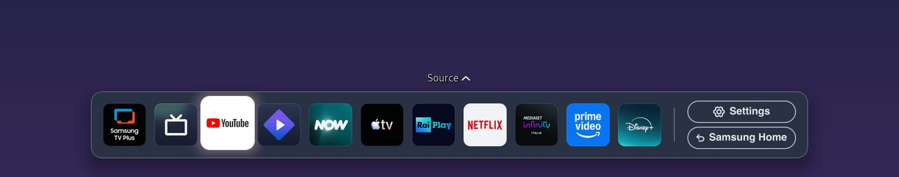
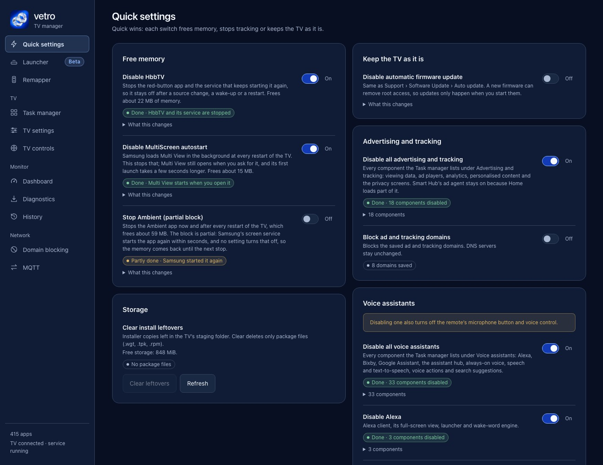

You can't reliably remove ads from the Samsung TV home screen with the stock menus. Some models and firmware versions offer no switch for promotional tiles, so what is left is partial: remove what the menus let you remove, block some ad requests on the network, or, on a rooted TV, stop using Samsung's Home and open another launcher on the Home key. This page covers each route and where it stops working.

## Can the Samsung menus remove home screen ads?

Very little, and it depends on the TV. On 29 November 2025 the owner of a 2025 Q6F wrote in [Samsung's US community](https://community.samsung.com/us/conversations/QLED-and-The-Frame-TVs/2025-Samsung-Q6F-No-Option-to-Disable-Home-Screen-Promotional/us_3417316) that, after checking many menus, there was no way to switch off home screen promotional previews for apps such as Fandango, Tubi and Pluto. Two later owners agreed, on 23 December 2025 and 15 January 2026. The thread shows no reply from Samsung staff and is archived and closed. It covers one model and one firmware, so it doesn't prove every TV behaves the same way.

A Samsung community manager answered a similar question on a QLED TV in June 2025: [there is no way to remove the suggested-apps list, but you can delete individual suggested apps](https://community.samsung.com/us/conversations/QLED-and-The-Frame-TVs/How-to-remove-suggested-apps/us_3254013) by holding the middle button over the app.

The menus do let you:

- Delete apps you don't use from the Home row.
- Delete Samsung TV Plus channels and hide its tile (see [removing Samsung TV Plus](/speed/disable-samsung-tv-plus/)).
- Change privacy and advertising settings, which affect how the TV personalises ads, not whether the tiles exist. Names and paths vary by model and year; [the Samsung ads opt-out guide](/privacy/samsung-ads-opt-out/) covers them.

If you only want fewer ads and don't want to modify the TV, stop here. Rooting is a bigger step than the problem deserves for most people.

## Does DNS blocking remove home screen ads?

It helps with some requests and fails at others. A DNS filter (on your router, a Pi-hole, or on the TV itself) stops the TV from reaching listed hostnames. It can't remove a tile that Samsung's Home draws from content the TV already has, and a list that is too broad can break features.

Vetro's records show the trade-off. According to its [CHANGELOG](https://github.com/andrearicci93/vetro/blob/main/CHANGELOG.md), the Home-picture host `cdn-stv.adgrx.com` ([#79](https://github.com/andrearicci93/vetro/issues/79), [#109](https://github.com/andrearicci93/vetro/issues/109)) stays out of the default lists because blocking it alone does not remove pictures already cached. The [domain filter notes](https://github.com/andrearicci93/vetro/blob/main/app/docs/DOMAIN-FILTER.md) list names the filter refuses to block because the TV uses them for its online check, its clock and the developer certificate. The README says domain filtering does not guarantee that every app's ads or telemetry are blocked.

The longer treatment is in [blocking Samsung TV telemetry with DNS](/privacy/block-samsung-tv-telemetry-dns/).

## What does a launcher change?

The promotional content is part of Samsung's Home, a system app (`com.samsung.tv.csfs` on the Q80A, per the changelog). A launcher is a different app that opens on the Home key. If Samsung's Home isn't on screen, its tiles aren't either.

Vetro's launcher is native: a glass-style bar at the bottom of the screen. According to the [README](https://github.com/andrearicci93/vetro/blob/main/README.md) it shows the same apps and icons as Samsung's Home, in the same order, and comes back by itself after a restart or a standby. It also has Source and Settings entries and a Samsung Home button, so nothing is removed and Samsung's Home is one press away. While the launcher is on, Samsung's Home is closed.

Vetro is experimental, needs root and ships no signed installer: you sign the package with your own Samsung certificate or install it through a tool such as Apps2Samsung. Read [whether rooting a Samsung TV is safe](/root/is-it-safe-to-root-samsung-tv/) and [how to install Vetro with Apps2Samsung](/root/install-vetro-apps2samsung/) before you start. The root comes from Chris Ritsen's [samsung-tv-root research](https://github.com/chris-ritsen/samsung-tv-root), and [Vetro's root requirements](/root/how-to-root-samsung-tv/) are a separate matter from the launcher itself.

What else to know:

- The launcher is in beta. Vetro is unaffiliated with Samsung.
- The bar has no promotional rows of its own, but Samsung's Home, one press away, still does.
- Vetro is developed on the Samsung Q80A ([tested TV page](/tested-tvs/q80a/)). The README table lists other models as "reported working", some with fixes, and the [list of tested TVs](/tested-tvs/) has the rest.

[A custom launcher for a Samsung TV](/speed/custom-launcher-samsung-tv/) explains how the launcher is wired in and why Vetro keeps Samsung's Home enabled.

### Does the launcher make the TV faster?

It frees memory. On the Q80A, available RAM went from 533 MB with Samsung's Home running to 662 MB with the launcher on, about 129 MB or 24% more. The [performance notes](https://github.com/andrearicci93/vetro/blob/main/app/docs/PERFORMANCE.md) describe this as a single run taken by hand, not repeated, on firmware 2301.1, and it measures memory only. It shows nothing about frame rate, input latency or the time an app takes to open. We explain the numbers in [what uses memory on a Samsung TV](/speed/samsung-tv-memory-usage/) and [why a Samsung TV gets slow](/speed/samsung-tv-slow-fix/).

## What else can Vetro do on a rooted TV?

Vetro's Quick settings has a switch that adds ad and tracking domains to a filter that runs on the TV itself, keeping your DNS servers, and another that disables advertising and tracking components, which includes the services that recognise what is on screen. Each shows Done or Partly done and can be switched back. Both act on background services and requests, and neither removes the tiles. The changelog notes that the effect on recognition and suggestions of the viewing-data switch has not been verified.

The Task manager can disable or stop individual components. Disabling keeps a component installed and is reversible. On TVs other than the Q80A some packages are unclassified and left alone.

## What can you adjust in the launcher?

The changelog for 0.5.0 lists these launcher options, and none involve ads:

- HDMI sources on Home shows the HDMI tiles that are already in Samsung's Home row, in the same positions, and HDMI source images uses Samsung's artwork instead of generic icons. Both are off by default and were tested on an S95C ([#34](https://github.com/andrearicci93/vetro/pull/34)).
- Reduce motion turns off all launcher animations.
- Fix TizenTube gives the TizenTube tile the YouTube icon and closes Samsung's YouTube before TizenTube starts.
- The app list is read from Samsung's Home each time the launcher starts, so apps you add, remove or reorder there follow. On TVs where the Home row holds only recent apps, the launcher adds the other visible installed apps.

Home-row order follows Samsung's saved row, but on layouts that contain only recent apps, Vetro also adds other visible installed apps. Removing a tile from the row may therefore leave the app visible in Vetro. A promotional tile that can't be removed isn't an app in that row, so we expect the launcher not to show it, but we haven't checked that tile by tile.

## In what order should you try things?

From least to most invasive:

1. Use the menus. Delete apps you don't want from the Home row, delete Samsung TV Plus channels and review the advertising and privacy settings. This needs only the remote.
2. Block at the network. A router-level or Pi-hole filter covers every device that uses it and leaves the TV alone, but it won't remove tiles that are already cached.
3. Switch off background services. On a rooted TV, Vetro's Quick settings can stop components that recognise what is on screen, send usage logs and fetch ads. This is about data and requests, not about the layout of Home.
4. Replace Samsung's Home. Vetro's launcher requires root. AeroTizen also documents no-root Home modes; see the [launcher comparison](/compare/vetro-vs-aerotizen-free-my-tv-tizenbrew/) for their compatibility limits.

Each step reverses differently. Menu changes go back in the menu. Vetro's switches show Done or Partly done and can be turned back on. The 0.5.0 changelog also adds Restore the TV, which shows the changes Vetro recorded and puts them back after one confirmation; uninstalled apps and settings without a saved previous value need manual recovery, and the changelog says Restore the TV has not been tried on a TV.

## What does the Vetro setup involve?

The [installation guide](https://github.com/andrearicci93/vetro/blob/main/app/docs/INSTALLATION.md) describes three routes: Apps2Samsung, a coding agent, or manual signing with Tizen Studio. All of them end the same way: open Vetro once on the TV, set Host PC IP to `127.0.0.1` in Developer Mode and restart. After a cold boot, startup and root can take up to 90 seconds. The root runs through TV-local SDB, so no computer needs to stay connected.

The dashboard is served over plain HTTP. Once the Vetro app on the TV has been seen, each browser pairs once with a six-digit code shown on the TV; until then the dashboard is open to the local network, as [SECURITY.md](https://github.com/andrearicci93/vetro/blob/main/SECURITY.md) explains. Keep the TV on a trusted network. For the steps, see [Developer Mode](/root/samsung-tv-developer-mode/) and [installing Vetro with Apps2Samsung](/root/install-vetro-apps2samsung/).

## What has gone wrong for other people?

The changelog and README table are candid about it, which is what "beta" means in practice:

- On two 2022 TVs, a UE65BU8002KXXH ([#22](https://github.com/andrearicci93/vetro/issues/22), [model page](/tested-tvs/bu8002/)) and a QE75QN85BATXXU ([#25](https://github.com/andrearicci93/vetro/issues/25), [model page](/tested-tvs/qn85b/)), turning the launcher on failed with "The Home row is empty or unreadable". Those TVs keep Samsung's Home order cache in a different folder, which release 0.3.1 reads.
- The 0.3.2 notes described a single-process limitation on Tizen 9. Version 0.5.0 added a multi-app Home guard; no Tizen 9 memory-saving measurement is published.
- Some models run the dashboard but have not tried the launcher. The Frame ([LS03B](/tested-tvs/ls03b/), [#39](https://github.com/andrearicci93/vetro/issues/39)) is one: its report says the launcher was not tried.

The [tested TVs index](/tested-tvs/) shows which confirmed cases exist.

## Why isn't there a simple switch from Samsung?

We can't speak for Samsung. The threads above show owners who were surprised by promotional tiles, and in one case planned to get rid of the TV. Samsung's answer in the June 2025 thread was to delete suggested apps one by one. If this matters to you, check the settings of a specific model and firmware before buying, since the answer changes between years.

## Limits

We haven't counted tiles or measured how much advertising a TV shows with and without the launcher, and Samsung changes Home between firmware versions. Check warranty and legal questions about rooting against Samsung's terms for your country.

## Next steps

Read [the custom launcher guide](/speed/custom-launcher-samsung-tv/), then [the safety page](/root/is-it-safe-to-root-samsung-tv/) before you touch root. Without root, start with [the ads opt-out guide](/privacy/samsung-ads-opt-out/).
