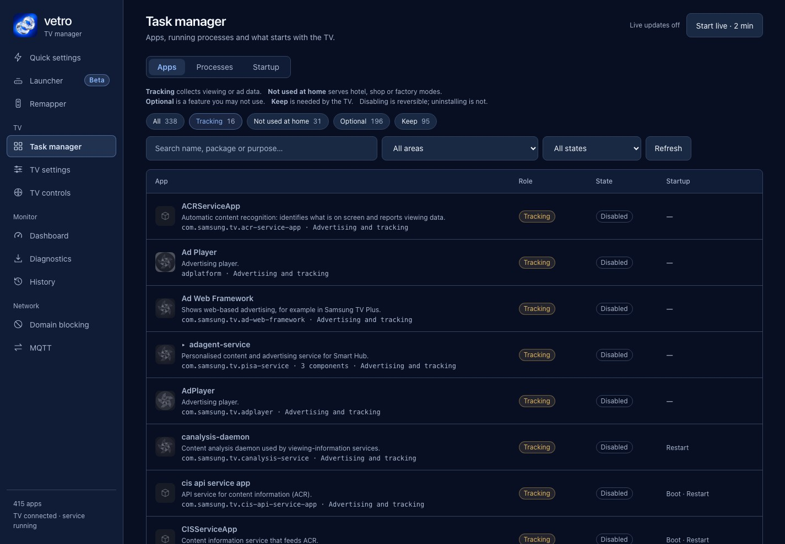

On a Samsung Q80A ([model page](/tested-tvs/q80a/)), Samsung's Home (the process `com.samsung.tv.csfs`) held about 152 MB of resident memory, HbbTV about 22 MB, MultiScreen about 15 MB and Ambient about 59 MB, according to Vetro's [performance notes](https://github.com/andrearicci93/vetro/blob/main/app/docs/PERFORMANCE.md) and [0.3.0 changelog](https://github.com/andrearicci93/vetro/blob/main/CHANGELOG.md). All of it comes from one TV, and all of it is resident-memory readings, not the "memory used" figure the TV shows. This page explains the difference and how to read the counters.

## Should I look at available RAM or used RAM?

Use available RAM. Tizen runs on Linux, which keeps spare memory as cache and gives it back when an app needs it, so a high "used" figure doesn't mean trouble. The kernel's [proc documentation](https://www.kernel.org/doc/html/latest/filesystems/proc.html) defines `MemAvailable` as an estimate of how much memory is available for starting new applications without swapping, and `MemFree` as only the totally unused part. The performance notes make the same point: available RAM is more useful than a simple used-RAM total.

Two more cautions from the notes:

- Zram (compressed memory used as swap) has a logical size and a physical size. The swap a TV reports as occupied is not the same as the memory the compressed copy takes.
- Major page faults include loading files from storage as well as swapping, so they don't directly measure how long something stalled.

Vetro's dashboard leaves a counter as unavailable when the TV doesn't report it, rather than showing it as zero.

## Which components use memory?

The table gives what Vetro's notes record for the Q80A. Resident set size (RSS) counts shared pages, so it overstates the memory you would get back. Proportional set size (PSS) splits shared pages between the processes that use them, which is why it is smaller.

| Component | Size | Source |
| --- | ---: | --- |
| Samsung Home, `com.samsung.tv.csfs` | about 152 MB RSS (PSS about 100 MB) | performance notes, 2026-10-23 run |
| Vetro launcher | about 22 MB RSS (about 30 MB in a later read, PSS 5.7 MB) | same run |
| HbbTV | about 22 MB | CHANGELOG 0.3.0, Q80A process survey |
| MultiScreen (Multi View) autostart | about 15 MB | CHANGELOG 0.3.0, Q80A process survey |
| Ambient | about 59 MB | CHANGELOG 0.3.0, Q80A process survey |

In the one run measured with the launcher, available RAM went from 533 MB to 662 MB, about 129 MB or 24%, on firmware 2301.1. The notes describe it as a single run taken by hand during development, not an A/B test and not repeated.

### Does stopping them free that much?

Not necessarily. The 0.3.0 changelog's sizes for HbbTV, MultiScreen and Ambient come from a survey of a running Q80A, and the [CHANGELOG](https://github.com/andrearicci93/vetro/blob/main/CHANGELOG.md) says the effect of each change on a running TV is not yet verified.

HbbTV and Ambient also restart themselves on this TV. According to the changelog, turning HbbTV off in the menu does not stop the app, and a firmware service starts it again at boot, on a source change and on wake. The 0.3.0 notes described Ambient returning after a stop. The 0.5.0 changelog reports that Stop Ambient is more reliable on the Q80A and stays stopped after a restart; users can still open Ambient themselves. Other firmware needs verification.

## How do I see memory use on the TV?

On a rooted TV, Vetro's dashboard shows CPU, RAM, swap, storage and processes. Live sampling starts when you ask and stops after two minutes (README). The notes measured the service and root agent at 0.44 to 0.51% of one core with the dashboard closed, 0.72 to 0.79% on the summary view and 2.07% in the Task manager. These are percentages of one core, not of the four.

Vetro is experimental, needs root and ships no signed installer. See [whether rooting a Samsung TV is safe](/root/is-it-safe-to-root-samsung-tv/) and [how to install Vetro with Apps2Samsung](/root/install-vetro-apps2samsung/). [Vetro's root requirements](/root/how-to-root-samsung-tv/) cover the rest.

## Why is the load average high on an idle TV?

Linux load counts runnable tasks and tasks waiting in uninterruptible sleep. The performance notes say a high load average with modest CPU doesn't by itself point to flash I/O, a broken service or something you can remove. A read-only sample on the Q80A found stable uninterruptible threads and little measured storage activity, and it did not establish an I/O or logging bottleneck. Don't read the load figure as "the TV is overloaded".

## How do I measure my own TV?

Use the same conditions each time: same apps open, same time since boot, same network. The benchmark in the notes waits 30 seconds, opens five apps with 25 seconds after each launch and samples memory, swap and processes about every three seconds. You don't need that much. Take available RAM after a cold boot, after the apps you use most, and after a change, and compare.

The dashboard requests a summary every five seconds and the full monitor every ten, pauses when the view is hidden and keeps a shared 30-second cache for storage. Other open browser tabs can still collect data.

For stock-menu steps, see [Samsung TV slow fixes](/speed/samsung-tv-slow-fix/). For what replacing Samsung's Home does and doesn't change, see [removing ads from the home screen](/speed/remove-ads-samsung-tv-home-screen/).

## Can I tune the Samsung TV kernel?

The notes say no tuning is offered. The TV reports Linux 4.1.10, a vendor kernel with differences from upstream, so modern advice on swappiness, storage schedulers or CPU governors can't be assumed to apply. They also record that experiments with compositor effects were abandoned after lag and connection-loss reports.

## What do the numbers not show?

They don't show frame rate, input latency or time to open an app. The notes call for repeated ABBA trials with the same network, workload and boot age before any such claim, and point out that a 60 Hz display doesn't mean every app produces 60 frames. Your numbers will differ with model, firmware and what is running. Version 0.5.0 added a multi-app Home guard, but publishes no memory measurement for Tizen 9.

## Next steps

Read [a custom launcher for a Samsung TV](/speed/custom-launcher-samsung-tv/) for how the swap works, [Samsung TV slow fixes](/speed/samsung-tv-slow-fix/) for stock-menu steps, and [whether root stays after a restart](/root/keep-root-after-restart/).
