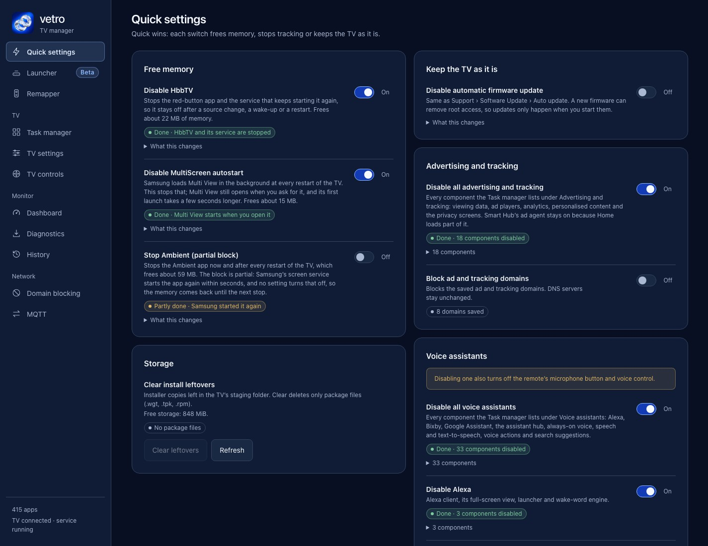

To stop Samsung TV automatic firmware updates, open Settings, go to Support, then Software Update, and if Auto Update is on, select it once to turn it off. That covers firmware installs only: Samsung says app and Smart Hub updates continue. On a rooted TV the toggle is not enough to protect root: a forced update has already removed root from a TV with it off ([#223](https://github.com/andrearicci93/vetro/issues/223)). This page gives Samsung's menu path, the router option and what Vetro 0.7.1's update lock does.

## How do I turn off Auto Update in the menu?

[Samsung's US support page](https://www.samsung.com/us/support/answer/ANS10002051/) gives these steps. Menu names and layout differ between models and years.

1. Open Settings, choose All Settings, then Support.
2. Select Software Update.
3. Look at Auto Update. If it is on, select it once to turn it off. If it is already off, leave it.

Samsung says that agreeing to the Smart Hub terms during first setup turns Auto Updates on automatically, and that after an update your video and audio settings might be reset to defaults. You can still check by hand with Update Now.

If Software Update is greyed out, Samsung says a streaming app is running in the background; switch to the TV input or press the Samsung TV Plus button on the remote.

## Why does the TV still update some things?

Samsung's page states that "other app updates or Smart Hub updates will download and install automatically." The Auto Update toggle is about the TV software; app and Smart Hub updates are separate.

Vetro's [guide to blocking updates without root](https://github.com/andrearicci93/vetro/blob/main/app/docs/UPDATES-WITHOUT-ROOT.md) goes further. It says Auto update only decides what the TV does with a firmware image it has already found, and lists four update paths that run on their own: over-the-air firmware, app and package updates, app-binary downloads and system components. With the toggle off, the background firmware loop still starts and the other three never look at the setting.

## Can I block updates on my router?

Yes. Vetro's [without-root guide](https://github.com/andrearicci93/vetro/blob/main/app/docs/UPDATES-WITHOUT-ROOT.md) says that without root the network is the only reliable block, and recommends denying the TV internet access on the router for both IPv4 and IPv6, or putting it on a network that reaches your home devices but not the internet. If you need streaming apps, allow only the hosts they use. It also says a DNS blocklist alone is not enough, because the TV can reach a host by its address, use another resolver or go over IPv6. A complete cutoff, over IPv4 and IPv6, blocks the updates that come over the network, while a firmware file on a USB stick still installs without any network. The owner in #223 had a partial block: they blocked selected DNS resolvers on the router, used DNS filtering and turned IPv6 off on the TV, and the update still arrived. They did not report cutting the TV off from the internet.

Blocking only update hostnames is a smaller step, and it leaves gaps. According to Vetro's [domain filter notes](https://github.com/andrearicci93/vetro/blob/main/app/docs/DOMAIN-FILTER.md), the Q80A firmware references `sas.samsungcloudsolution.com` and `sas.samsungcloudsolution.net` as its software-update servers. Blocking those names alone does not cover every update connection. The notes say Vetro's filter does not refuse them, because blocking them is a decision for the owner, and point to a Quick settings switch that is easier to undo and covers the other update services too.

Vetro 0.7.1 adds two more names, `otn2.samsungcloudcdn.com` and `qoe.samsungcloud.tv`. The [CHANGELOG](https://github.com/andrearicci93/vetro/blob/main/CHANGELOG.md#update-lock) says one owner reported them and that blocking them stopped the "update available" notice. Vetro blocks them only while its update switch and Enable DNS blocking are both on and Vetro runs, so the [without-root guide](https://github.com/andrearicci93/vetro/blob/main/app/docs/UPDATES-WITHOUT-ROOT.md) suggests adding them to your router or Pi-hole as well. That is one owner's report, not a tested list.

The two `sas` names come from Q80A firmware ([model page](/tested-tvs/q80a/)). They are not a tested blocklist for other Samsung TVs, and a router or DNS rule only affects the devices it covers. Filters can also break features, so read [blocking Samsung TV telemetry with DNS](/privacy/block-samsung-tv-telemetry-dns/) before you edit lists.

The root research behind Vetro mentions that its author's TVs are blocked from the internet after Developer Mode is enabled ([samsung-tv-root README](https://github.com/chris-ritsen/samsung-tv-root)). That is the author's setup, not advice.

## What does Vetro's switch do?

Vetro has a Block firmware and software updates switch in Quick settings, General, Essential settings. The 0.7.0 version replaced the 0.5.0 switch, which only set the menu's Auto update value. It is off until you turn it on and needs root; without root the dashboard shows Root required and points to the network block above. The dashboard's description warns that Samsung is trying to block root with remote firmware updates.

According to the [CHANGELOG](https://github.com/andrearicci93/vetro/blob/main/CHANGELOG.md), the switch stops and masks the update services it knows, not just the menu setting: the background firmware loop, the app and package updater, the app-binary manager, the system component updater and the preview updater. It turns the auto-update and app-binary switches off, removes the download markers and applies the lock again after every restart. On TVs that run the AT-HUB boot step (Tizen 6, 6.5 and 9) the lock is applied at power-on, before the update services start; on other firmware it starts with Vetro's root agent. USB recovery is left working, and turning the switch off restores the previous Auto update value.

Vetro 0.7.1 extends the switch after [#308](https://github.com/andrearicci93/vetro/issues/308), where a Samsung firmware update reached an S85F that had the earlier block on; the [CHANGELOG](https://github.com/andrearicci93/vetro/blob/main/CHANGELOG.md#update-lock) says what happened there is not known yet. Samsung's update software can ask the TV to restart into a separate update mode, which starts before any app, Vetro included, and installs from Samsung's servers. The switch now removes that request when it is turned on, at every restart and as soon as it is written, and keeps off Samsung's own setting that lets an update too big for the TV's storage be downloaded in that mode. It also stops one more update service and adds the two update servers above to Vetro's DNS blocking list. A TV that had the switch on before 0.7.1 gets this at the first start of 0.7.1. One consequence: a USB update from the TV menu needs the switch off. None of the 0.7.1 additions has been tried on a TV yet.

Two limits come with it. The behavior was read from the Tizen 6, 6.5 and 9 firmware, and the test is narrow: on a Q80A ([model page](/tested-tvs/q80a/)) with firmware 2310.0, the masks on the update services were in place after a cold reboot, before Vetro's own service started. No TV has been tested against a forced update like the one in #223, and other models are not tried. And it is designed to block Samsung's firmware and app updates, so security fixes wait until you turn it off. An update got through the earlier lock on an S85F. It can help keep root; it does not guarantee it, and a firmware update that lands anyway replaces everything it does.

Vetro is experimental, needs root and ships no signed installer. Read [whether rooting a Samsung TV is safe](/root/is-it-safe-to-root-samsung-tv/) and [how to install Vetro with Apps2Samsung](/root/install-vetro-apps2samsung/) before relying on it, and see [Vetro's root requirements](/root/how-to-root-samsung-tv/) for the route. If your TV still roots, turn the switch on before the next update rather than after.

## Which option is for whom?

| Option | Needs root | What it covers | Caveat |
| --- | --- | --- | --- |
| Menu toggle (Support, Software Update, Auto Update) | No | What the TV does with a firmware image it found | App and Smart Hub updates continue; other update paths never read it |
| No internet for the TV on the router (IPv4 and IPv6) | No | Every update that needs the network | Streaming apps need their hosts allowed; A router cutoff alone still allows an offline USB update |
| DNS or hostname block | No | Names the TV looks up through your resolver | Does not cover every update connection; hosts taken from Q80A firmware and one owner's report, not a tested list |
| Vetro's Block firmware and software updates | Yes | Samsung's known update services, blocked again at each boot; from 0.7.1 it also clears the request to enter Samsung's separate update mode and keeps its large-update setting off | Checked on a Q80A only, not against a forced update; 0.7.1 additions not tried on a TV; Samsung's app updates stop too; turn it off for a USB update from the menu |

Without root, the menu toggle only changes how firmware updates are handled; the router rule is what blocks the background paths. On a rooted TV you want to keep rooted, use Vetro's switch while root works, and add the router rule if you want a block that lives outside the TV.

## Is turning it off a good idea?

Turning Auto Update off only changes how the TV handles a firmware image it finds. Background updates can still run, and a forced update may still install. Holding updates back also delays security fixes, and Vetro's switch holds back app updates as well. If you rely on root, read [will a firmware update remove root](/updates/firmware-update-remove-root/) to see what Vetro's records show, and [can you downgrade firmware](/updates/downgrade-samsung-tv-firmware/), because going back is usually not possible.

## Limits

Samsung's US page is the source for the menu path, and your TV's wording may differ, especially outside the US or on older models. We haven't tested whether a firmware prompt can still appear with the toggle off. Vetro's switch was checked on a Q80A only, after a cold reboot, and never against a forced update like the one in #223; its 0.7.1 additions have not been tried on a TV. Nothing here is warranty or legal advice.

## Next steps

See [what each Vetro switch changes](/reference/what-each-vetro-switch-changes/) and [how root behaves after a restart](/root/keep-root-after-restart/).
